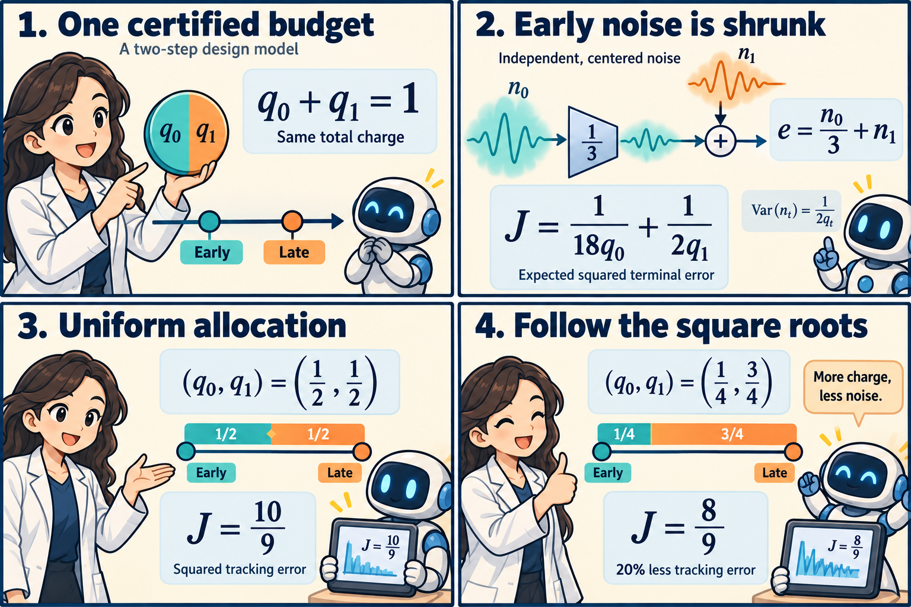

## The paper and the question

Umberto Biccari and Yongcun Song's *When to spend privacy: optimal allocation in private learning* (29 October 2026) optimizes a noise schedule using a public design model. Their PB-AMD method combines adjoints with budget-preserving entropic updates. Its linear–quadratic case has an explicit allocation rule. [Full paper, Sections 2–4](https://arxiv.org/html/2610.39954v1#S4.SS4).

The useful question is how much of an early perturbation survives until the end. The following original two-step calculation separates the total privacy certificate, the timing of noise, and the reliability of the model used to choose that timing.

## Four panels, one budget



*The total certified charge stays at one. Shrinking early noise makes later noise more consequential. Allocating charges in a one-to-three ratio reduces expected squared terminal error from 10/9 to 8/9 in this design model.*

## Keep charge and noise distinct

For a Gaussian query with sensitivity bounded by \(\Delta\) and noise standard deviation \(\Delta\sigma_t\), the certified zero-concentrated differential privacy (zCDP) charge is

$$
q_t=\frac{1}{2\sigma_t^2},\qquad
\sigma_t^2=\frac{1}{2q_t},\qquad
\sum_tq_t\leq R.
$$

These are additive upper-bound certificates, not measurements of actual leakage. Schedule selection must use data-independent information or have its own privacy cost accounted for; private training uses fresh noise. [Section 2.2](https://arxiv.org/html/2610.39954v1#S2.SS2).

Increasing \(q_t\) buys less noise at step \(t\), while consuming more of the allowed certificate. Equal total charges therefore leave a genuine allocation problem. We will fix \(R=1\) and use \(q_0,q_1\geq 1/10\), with \(q_0+q_1=1\).

## An exact public design model

Let \(n_0,n_1\) be independent, centered Gaussian errors with
\(\operatorname{Var}(n_t)=1/(2q_t)\). Start with zero deviation from a noiseless reference, and define

$$
e_1=n_0,\qquad e_2=\frac13e_1+n_1.
$$

The factor \(1/3\) models a deterministic contraction between the two perturbations. Step sizes and calibrated noise scales are set to one. All utility calculations below concern this public linear design model; it supplies no private gradient query by itself.

Take the utility criterion to be expected squared terminal deviation, \(J=\mathbb E[e_2^2]\). Independence removes the cross term:

$$
\begin{aligned}
J(q_0,q_1)
&=\frac19\mathbb E[n_0^2]
  +\mathbb E[n_1^2]
  +\frac23\mathbb E[n_0n_1]\\
&=\frac{1}{18q_0}+\frac{1}{2q_1}.
\end{aligned}
$$

For the same injected variance, the early noise contributes only one ninth as much terminal squared error as the late noise. This conclusion uses both the contraction and the absence of correlated errors.

Three feasible schedules illustrate what that means:

| Allocation | Charges \((q_0,q_1)\) | Tracking error \(J\) |
| --- | --- | --- |
| Uniform | \((1/2,1/2)\) | \(10/9\) |
| Proportional to error coefficients | \((1/10,9/10)\) | \(10/9\) |
| Proportional to their square roots | \((1/4,3/4)\) | \(8/9\) |

The second row shows that assigning nine times as much charge to the more costly step can overcorrect. The square-root schedule gives three times as much charge instead. Its relative error reduction is

$$
1-\frac{8/9}{10/9}=\frac15=20\%.
$$

At that schedule, the noise variances are \((2,2/3)\), compared with \((1,1)\) under uniform allocation. We deliberately tolerate more early noise because the remaining dynamics suppress it. The percentage describes this squared-error criterion, not an accuracy gain.

## Derive the square root

Write a linear model's objective as \(J(q)=\sum_t c_t/q_t\), with \(c_t>0\). Each coefficient combines the injection scale with downstream propagation. For positive charges totaling \(R\), Cauchy–Schwarz gives

$$
\left(\sum_t\sqrt{c_t}\right)^2
=\left(\sum_t\sqrt{\frac{c_t}{q_t}}\sqrt{q_t}\right)^2
\leq J(q)R.
$$

Equality requires \(\sqrt{c_t/q_t}\) proportional to \(\sqrt{q_t}\), hence

$$
q_t^*=\frac{R\sqrt{c_t}}{\sum_s\sqrt{c_s}}.
$$

Here \(c=(1/18,1/2)\), so \(\sqrt{c_0}:\sqrt{c_1}=1:3\). The resulting charges \((1/4,3/4)\) exceed the floor, making the bound attainable. Strict convexity gives uniqueness.

The marginal calculation explains the same balance. An interior optimum equates \(c_t/q_t^2\) across steps. At our solution,

$$
\frac{1/18}{(1/4)^2}
=\frac{1/2}{(3/4)^2}
=\frac89.
$$

The expensive step receives more charge until the benefit from the next small charge transfer is equal at both steps. If a floor binds, the unconstrained square-root formula needs adjustment; one must enforce the floors and total budget together.

The paper establishes this structure for deterministic linear transitions and quadratic terminal losses; its nonlinear optimization guarantees concern stationarity under regularity assumptions. [Section 4.4 and Appendix C.4](https://arxiv.org/html/2610.39954v1#A3.SS4).

## A transfer stress test

Now change only the propagation model: early noise is carried forward with factor one instead of one third. Keep independent noise and the same injection scales. The new criterion is

$$
J_{\mathrm{new}}(q)=\frac{1}{2q_0}+\frac{1}{2q_1}.
$$

The public model's selected schedule gives \(J_{\mathrm{new}}(1/4,3/4)=8/3\). Uniform allocation gives \(2\) and is now optimal. Thus the previously successful schedule is one third worse than uniform under the new dynamics, despite keeping the same total certified charge.

This is an explicit model-mismatch calculation. Applied to a separately calibrated private mechanism, both allocations retain the same upper-bound certificate. That certificate says nothing about which one gives better tracking. A controller that learns an inaccurate propagation model can spend its fixed resource in the wrong places.

There is no universal instruction to spend more at the end. In a general two-step scalar model with propagation factor \(a\) and unit injection scales, the interior ratio is \(q_0:q_1=|a|:1\). Contraction favors the later step; amplification favors the earlier one. At \(a=0\), the early coefficient vanishes and the positive floor becomes important.

## Reproduce the numbers

```python
from fractions import Fraction as F

def tracking(q, a=F(1, 3)):
    return a*a / (2*q[0]) + 1 / (2*q[1])

uniform = (F(1, 2), F(1, 2))
coefficient = (F(1, 10), F(9, 10))
optimal = (F(1, 4), F(3, 4))
assert all(sum(q) == 1 and min(q) >= F(1, 10)
           for q in (uniform, coefficient, optimal))
assert tracking(uniform) == F(10, 9)
assert tracking(coefficient) == F(10, 9)
assert tracking(optimal) == F(8, 9)
assert 1 - tracking(optimal) / tracking(uniform) == F(1, 5)
assert tuple(1 / (2*x) for x in optimal) == (F(2), F(2, 3))
assert tracking(optimal, F(1)) == F(8, 3)
assert tracking(uniform, F(1)) == F(2)
```

## Research judgment

The paper's Fashion-restart results favor optimized allocation over uniform, with learning-rate allocation performing similarly. In the separate Nonlinear-head task, its average advantage over the linearized baseline remains statistically unresolved after correction. [Sections 5.2–5.4](https://arxiv.org/html/2610.39954v1#S5.SS2).

I would test propagation estimates before adding a more elaborate allocator. Compare uniform, learning-rate-only, linearized and nonlinear schedules on the same fixed certificate, using separate public schedule-selection data and evaluation noise. Report tracking and predictive utility separately, alongside the cost of designing the schedule.

For federated learning, the pertinent extension is how later aggregation and local optimization transform earlier injected noise. Changing participation or local step counts can change that transformation even when the total privacy certificate stays fixed. The stress test suggests a concrete experiment: design under one participation regime, deploy under another, and compare the selected schedule against uniform and a cheaply recomputed propagation baseline.

A complete theory would also need to distinguish deterministic propagation from random, correlated or state-dependent dynamics. Our cross term vanished by independence; it need not vanish in a broader model. The useful contribution of the toy calculation is an exact baseline for identifying which additional assumptions a proposed allocator needs.

## Sources

Umberto Biccari and Yongcun Song. *When to spend privacy: optimal allocation in private learning*. [arXiv:2610.39954v1](https://arxiv.org/abs/2610.39954v1), first public 29 October 2026. [Full text](https://arxiv.org/html/2610.39954v1), especially Sections 2 and 4.4 and Appendix C.4. The numerical example and transfer stress test above are original analysis.

The comic was created with AI.
