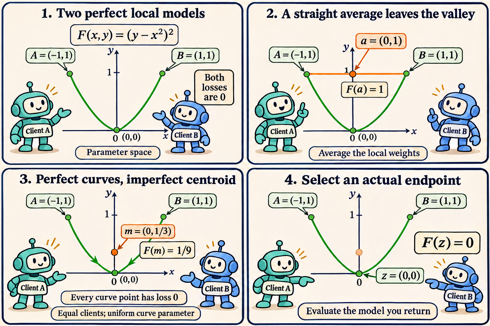

## The paper and the question

Federico Lucchetti and Marcus Völp's *CovFedAvg: Local Low-Loss Curves and Federated Model Selection* (29 October 2026) fits client-local curves to a shared endpoint and selects an actual candidate using distributed training losses. The current method is in Section 7; earlier calibration-based constructions are separate references. [Full paper](https://arxiv.org/html/2610.39902v1#S7).

Why select a model rather than average the curves' weights? The following original construction gives exact answers: zero loss everywhere on two paths, loss one at the local models' average, and loss one ninth at the paths' centroid.

## Four panels, one curved valley



*The coordinates are model parameters. The green parabola is the zero-loss set. The centroid is uniform in each curve's parameter, with equal client weights; it is not an average by arc length.*

## Start with two perfectly fitted models

Give both clients the same smooth loss in two parameters:

$$
F(x,y)=(y-x^2)^2.
$$

Its minimum is zero along the entire parabola $$y=x^2$$. Take local models and a possible common endpoint

$$
v_A=(-1,1),\qquad v_B=(1,1),\qquad z=(0,0).
$$

Each has loss zero. With equal client weights, the FedAvg parameter average is

$$
a=\frac{v_A+v_B}{2}=(0,1),\qquad F(a)=1.
$$

There is no client disagreement about the objective in this example. The failure comes entirely from the shape of its zero-loss set. The straight segment joins two points of a nonconvex set and leaves that set.

## Construct exact zero-loss Bézier paths

Use quadratic Bézier paths with controls $$c_A=(-1/2,0)$$ and $$c_B=(1/2,0)$$:

$$
\gamma_k(s)=(1-s)^2v_k+2s(1-s)c_k+s^2z,
\qquad 0\leq s\leq1.
$$

This uses the path form of Equation (34). [Section 7.1](https://arxiv.org/html/2610.39902v1#S7.SS1).

Expanding the coordinates gives

$$
\gamma_A(s)=\bigl(-(1-s),(1-s)^2\bigr),\qquad
\gamma_B(s)=\bigl(1-s,(1-s)^2\bigr).
$$

For either curve, the second coordinate is the square of the first. Therefore

$$
F(\gamma_A(s))=F(\gamma_B(s))=0
\quad\text{for every }s\in[0,1].
$$

This is a whole-path identity, not a conclusion from testing a few points. A control point need not lie on its Bézier curve: the two controls have loss $$1/16$$, while every point on the resulting paths has zero loss.

## Averaging the paths still adds loss

Integrating a quadratic Bézier path gives equal coefficients on its two endpoints and control:

$$
\int_0^1\gamma_k(s)\,ds=\frac{v_k+c_k+z}{3}.
$$

Here the individual path means are $$(-1/2,1/3)$$ and $$(1/2,1/3)$$. Their equally weighted centroid is consequently

$$
m=\frac12\int_0^1\bigl(\gamma_A(s)+\gamma_B(s)\bigr)\,ds
=(0,1/3),\qquad F(m)=\frac19.
$$

The average loss along the curves is zero, but the loss at their averaged parameters is positive. The two operations produce different quantities:

| Parameter operation | Resulting loss |
| --- | --- |
| Average the local endpoints | $$1$$ |
| Average all curve weights | $$1/9$$ |
| Choose the common endpoint | $$0$$ |

The centroid improves on the straight average without preserving the curves' perfect fit. This exact construction follows the two-client averaging operation in Equation (40). It illustrates the centroid limitation discussed in Proposition 5.6. [Sections 5.3 and 7.3](https://arxiv.org/html/2610.39902v1#S5.SS3).

## The loss equals a squared variance

There is a useful identity behind these fractions. Draw a client uniformly and draw $$s$$ uniformly on $$[0,1]$$. A random point on the resulting mixture of paths has coordinates $$(X,X^2)$$, with $$X$$ uniform on $$[-1,1]$$. Hence

$$
\mathbb E[X]=0,\qquad
\mathbb E[X^2]=\frac13,\qquad
\operatorname{Var}(X)=\frac13.
$$

More generally, let $$X$$ be any bounded random coordinate and let every sampled model be $$(X,X^2)$$. Its loss is identically zero. The loss at the parameter mean is

$$
\begin{aligned}
F\bigl(\mathbb E[X],\mathbb E[X^2]\bigr)
&=\left(\mathbb E[X^2]-(\mathbb E[X])^2\right)^2\\
&=\operatorname{Var}(X)^2.
\end{aligned}
$$

Parameter dispersion creates the departure from the curved valley. For the two original endpoints, that variance is one and the average's loss is one. For the uniform curve mixture, the variance is one third and the centroid's loss is one ninth. Concentrating all mass on the common endpoint makes the variance zero.

This also separates parameter averaging from prediction averaging. If $$y-x^2$$ is a model's residual, every path model has zero residual. An ensemble averaging those residuals also gives zero. The residual at the averaged parameters is instead $$1/3$$. Nonlinearity in the parameters prevents exchanging prediction and parameter averaging.

## What endpoint selection actually certifies

CovFedAvg selects among the old model, the current-round FedAvg anchor and fitted endpoints using a fixed weighted regularized training objective. Exact evaluation protects that objective relative to those candidates; it does not guarantee test improvement, per-client preservation or stationarity. [Section 7.2](https://arxiv.org/html/2610.39902v1#S7.SS2).

In our example, if the candidate set contains $$z$$, selecting by $$F$$ can attain zero loss. The geometry does not establish that a fitting routine will produce that candidate. In particular, our controls are half a unit below their straight-line midpoints. A bending penalty of the form

$$
\frac{\rho}{2}\left\|c_k-\frac{v_k+z}{2}\right\|^2
$$

would contribute $$\rho/8$$ on each client even though the path loss is zero. A soft fitting objective can trade bending against fit, and finite optimization adds another limitation.

Our loss is an unregularized polynomial chosen to expose geometry. It is not the paper's classification objective. Nor does this example make curve fitting necessary: at the anchor, $$\nabla F(0,1)=(0,2)$$, and one gradient step of size $$1/2$$ reaches $$z=(0,0)$$ directly. Any proposed geometric method should be compared with that alternative on its own problem and computational budget.

## Reproduce the fractions

```python
from fractions import Fraction as Q

vA, vB = (Q(-1), Q(1)), (Q(1), Q(1))
cA, cB = (Q(-1, 2), Q(0)), (Q(1, 2), Q(0))
z = (Q(0), Q(0))
def loss(w):
    x, y = w
    return (y - x*x)**2
def bezier(v, c, s):
    return tuple((1-s)**2*v[i] + 2*s*(1-s)*c[i] + s*s*z[i]
                 for i in range(2))
def path_mean(v, c):
    return tuple((v[i] + c[i] + z[i])/3 for i in range(2))
def average(a, b):
    return tuple((a[i] + b[i])/2 for i in range(2))
for j in range(9):
    s = Q(j, 8)
    assert loss(bezier(vA, cA, s)) == 0
    assert loss(bezier(vB, cB, s)) == 0
m = average(path_mean(vA, cA), path_mean(vB, cB))
assert m == (Q(0), Q(1, 3))
assert (loss(average(vA, vB)), loss(m), loss(z)) == (1, Q(1, 9), 0)
```

The expansion above proves the continuous identity; the loop supplies exact checks at selected rational parameters.

## Research judgment

The paper's matched direct-optimization control prevents attributing extra optimization work to curves. Its results do not establish a curve-specific advantage over that control. [Section 8](https://arxiv.org/html/2610.39902v1#S8).

I would separate three measurements in a model-merging study: loss on sampled path points, loss at the proposed aggregate, and loss at the model actually selected. Reporting the first alone leaves the central operation untested. The variance identity provides an exact diagnostic case for checking that an implementation evaluates the aggregate itself.

A more informative next experiment would hold gradient work and the number of selection opportunities fixed while varying the path representation. It should measure both source-client and unseen-domain performance. Shared low-loss regions may be absent, and a training-loss guard cannot supply missing domain coverage.

The conclusion from the example is narrow but decisive: even perfect local paths can lose their defining property when their parameters are averaged. Evaluating an actual candidate is part of the optimization problem, not a consequence of having drawn a low-loss curve.

## Sources

Federico Lucchetti and Marcus Völp. *CovFedAvg: Local Low-Loss Curves and Federated Model Selection*. [arXiv:2610.39902v1](https://arxiv.org/abs/2610.39902v1), first public 29 October 2026. [Full text](https://arxiv.org/html/2610.39902v1), especially Sections 5.3, 7 and 8. The parabolic construction, variance identity and direct-step comparison above are original worked analysis.

The comic was created with AI.
