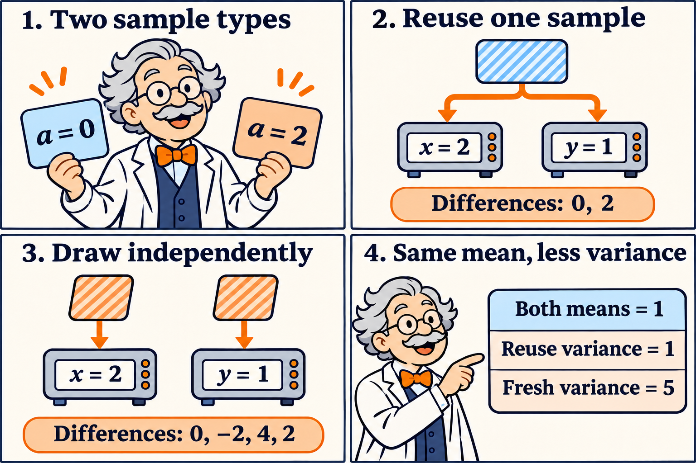

Two algorithms can spend the same number of gradient queries and learn different things. A worker that can revisit an example can measure how *that example's* gradient changes as the parameters move. A worker receiving a new example at each query also sees variation between examples. The distinction matters when local computation is cheap relative to communication.

[Novoselov, Dorn, Dvinskikh, and Gasnikov, *The Minimax Complexity of Federated Optimization under Interpolation: The Role of Oracle Models*, arXiv v1, October 28, 2026](https://arxiv.org/html/2610.38354v1), compare these forms of access. In their model, $$m$$ workers take up to $$K$$ sequential gradient queries per worker in each of $$N$$ rounds. Communication happens between rounds. Their convex sample losses share a minimizer $$x^\star$$, a condition called *interpolation*. Population smoothness is $$L$$, sample smoothness is bounded by $$H_s$$, and the starting point is within $$R$$ of $$x^\star$$. [Setting and oracle definitions](https://arxiv.org/html/2610.38354v1#S2).

## What changes when examples can be revisited?

An unbiased weak-growth oracle bounds the gradient second moment by $$2H_s[F(x)-F(x^\star)]$$. For interpolating smooth samples, this follows by taking one gradient step of size $$1/H_s$$ on a sample and comparing its resulting loss with the sample minimum. Averaging the resulting descent inequality gives the bound. A fresh gradient oracle supplies additional structure because each reply is a gradient of a smooth convex loss. Reuse additionally allows multiple evaluations of one indexed loss. [Lemma 4.1](https://arxiv.org/html/2610.38354v1#S4).

For a pool of $$S$$ samples, the reuse result gives the following worst-case expected population excess loss, up to logarithmic factors in the matching dimension regime:

$$
R^2\min\left\{L,\;
\frac{\min\{L,H_s/K\}}{N^2}+
\frac{H_s}{\min\{S,mKN\}}\right\}.
$$

The pool caps distinct observations, even as repeat queries consume computation. For quadratic population objectives, fresh gradients already attain the infinite-pool rate. For general convex objectives with fresh gradients, the lower and upper bounds can differ. The reuse theorem therefore leaves open whether fresh access can attain the same rate in that broader class. [Theorems 4.2 and 4.3](https://arxiv.org/html/2610.38354v1#S4) and [Theorem 5.1](https://arxiv.org/html/2610.38354v1#S5).

## Two queries with the same mean

Take a scalar sample loss $$f_a(x)=ax^2/2$$ with $$a=0$$ or $$a=2$$, each with probability one half. The gradient is $$g_a(x)=ax$$ and the population objective is $$F(x)=x^2/2$$. The flat sample and the curved sample both have a minimum at zero. Here $$L=1$$, $$H_s=2$$, and the weak-growth inequality is tight because $$\mathbb E[g_a(x)^2]=2x^2$$.

For fixed points $$x,y$$, a reused sample yields $$D_{\rm reuse}=a(x-y)$$. Independent samples yield $$D_{\rm fresh}=ax-by$$, with $$b$$ an independent copy of $$a$$. Since $$\mathbb E[a]=1$$ and $$\operatorname{Var}(a)=1$$, both differences have mean $$x-y$$, and

$$
\operatorname{Var}(D_{\rm reuse})=(x-y)^2,\qquad
\operatorname{Var}(D_{\rm fresh})=x^2+y^2.
$$

The difference of variances is $$2xy$$. With reuse, the two replies have covariance $$xy$$, which enters the variance of a subtraction with a minus sign. At $$x=2$$ and $$y=1$$ the calculation is exact:

- **Reuse.** The two equally likely differences are 0 and 2. Their mean is 1 and their second moment is 2, giving variance 1.
- **Fresh draws.** The four equally likely differences are 0, −2, 4, and 2. Their mean is 1 and their second moment is 6, giving variance 5.

The two sample cards represent the two possible curvatures. The reuse panel sends one card to both query points. The fresh panel draws separately at each point, which admits two additional differences. Both rules estimate the same gradient change.

At coincident points, reuse gives zero exactly. At opposite-sign points, the covariance changes sign and reuse can increase the variance. A general local bound explains why small displacements still favor paired measurements in many problems. For fixed $$x,y$$ and a common smooth sample, write $$D=\nabla f_a(x)-\nabla f_a(y)$$. Subtracting the mean cannot increase its second moment, so

$$
\mathbb E\|D-\mathbb E D\|^2
\leq \mathbb E\|D\|^2
\leq H_s^2\|x-y\|^2.
$$

For independent replies the corresponding centered second moment is the sum of the two marginal variances. It can stay positive as $$y$$ approaches $$x$$. In the toy, adding the exact anchor gradient $$F'(1)=1$$ turns the paired difference into a gradient estimate at $$x=2$$. Its values are 1 and 3, with mean 2 and variance 1. The known anchor is an illustration. In SVRG the anchor is computed on the actual stored batch, and its cost counts against the query budget.

## From a paired difference to a communication bound

The reuse algorithm approximately solves a regularized empirical problem on each worker. For batch average $$f_B$$ and center $$y$$, its exact proximal point $$p_B(y)$$ minimizes $$f_B(u)+\tau\|u-y\|^2/2$$. The resulting envelope gradient is $$\tau(y-p_B(y))$$. To see the smoothness mechanism, write $$d=y-y'$$ and $$q=p_B(y)-p_B(y')$$. Optimality and monotonicity of $$\nabla f_B$$ imply $$\langle d,q\rangle\geq\|q\|^2$$. Expanding $$\|d-q\|^2$$ then gives $$\|d-q\|^2\leq\|d\|^2-\|q\|^2$$. Thus the envelope gradient is $$\tau$$-Lipschitz, even if the batch loss has substantially higher curvature.

The local SVRG solve makes this smooth surrogate available within the round budget. Acceleration uses the resulting envelope directions, and a final proximal solve on an independent batch converts the envelope guarantee into a population loss bound. The matching lower bound uses hidden chain edges with persistent sample-specific masks. Revisiting a label preserves its masks, and a separate statistical lower bound accounts for the distinct labels available. [Appendix A.5](https://arxiv.org/html/2610.38354v1#A1.SS5) and [Appendix C](https://arxiv.org/html/2610.38354v1#A3).

The example isolates the covariance in one estimator. It leaves the minimax comparison to the paper's analysis, where algorithms may choose other estimators and fresh gradients can already exploit quadratic population structure. A practical comparison should hold both rounds and total gradient evaluations fixed, charge for anchor gradients, and vary the pool size separately. It should also measure what happens when workers' losses have different minimizers. In that setting an envelope can still be smooth, but the common-minimizer argument for transferring progress to the population no longer applies as stated.

The comic was created with AI.
