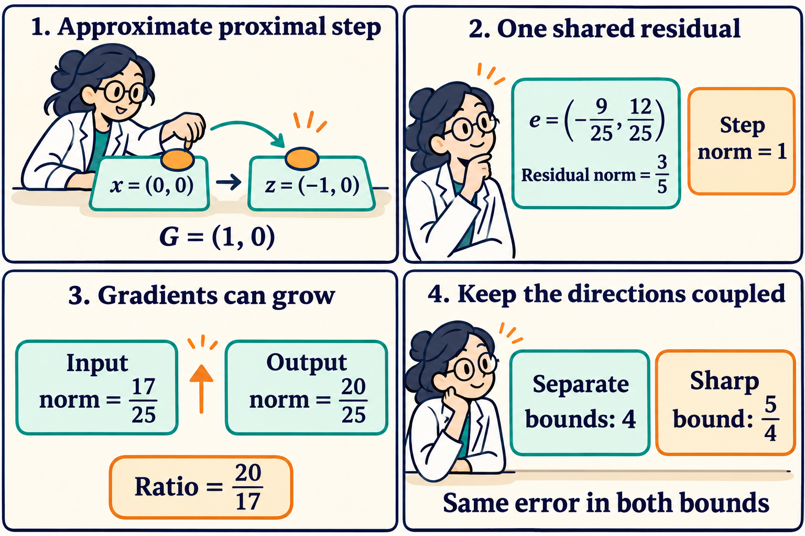

An approximate solver can lower the objective while increasing the gradient norm. To control that increase, it helps to retain the direction of its error. If two inequalities describe the same step, the error vector must satisfy both at once.

Shenghan Mei's *Tight Stationarity Transfer and Repeatability for Inexact Proximal-Gradient Methods*, first public on October 28, studies $$f+g$$ with smooth convex $$f$$ and weakly convex $$g$$. Weak convexity means that adding $$\rho\|w\|^2/2$$ makes $$g$$ convex. The paper measures directional stationarity by the largest decrease per unit direction, equivalently a minimum subgradient norm. It derives sharp transfer bounds by retaining one residual's magnitude and orientation. Finiteness requires $$\eta<1-\alpha\rho$$. In a regime with an interior maximizing orientation, the one-step worst case cannot persist across two consecutive steps of one objective. [Full paper, Sections 2–5](https://arxiv.org/html/2610.38310v1).

Here is an original calculation in the smooth convex special case $$f=0$$, $$\rho=0$$, with step size $$\alpha=1$$. This includes an iterative inner solver for a convex proximal subproblem, a useful abstraction when local optimization is expensive.

For input $$x$$ and candidate output $$z$$, set

$$
G=x-z,\qquad p=\nabla g(x),\qquad v=\nabla g(z),\qquad e=v-G.
$$

An exact proximal step minimizes $$g(w)+\|w-x\|^2/2$$ and therefore has $$e=0$$. An approximate step satisfies $$\|e\|\leq\eta\|G\|$$. Here $$e$$ is the violation of the subproblem's first-order condition. It is different from the distance to its exact minimizer. Directional stationarity in this smooth example is simply the gradient norm.

Assume $$G\neq0$$ and $$0\leq\eta<1$$. Separate triangle and monotonicity bounds give

$$
\|v\|\leq(1+\eta)\|G\|,\qquad
\|p\|\geq(1-\eta)\|G\|.
$$

For the second inequality, convexity gives $$\langle p-v,G\rangle\geq0$$, and $$v=G+e$$ then implies $$\langle p,G\rangle\geq(1-\eta)\|G\|^2$$. Dividing the two estimates gives $$\|v\|/\|p\|\leq(1+\eta)/(1-\eta)$$. At $$\eta=3/5$$ this is 4.

The first estimate is largest when the residual points along $$G$$. The second permits the smallest input gradient when it points against $$G$$. One residual cannot take both directions during the same step.

To keep the shared direction, let $$t=\|G\|$$ and $$s=\langle e,G\rangle/t^2$$. Since $$-\eta\leq s\leq\eta$$, monotonicity and Cauchy–Schwarz imply $$\|p\|/t\geq1+s>0$$. Expanding the output norm gives

$$
\frac{\|v\|^2}{t^2}
=1+2s+\frac{\|e\|^2}{t^2}
\leq1+2s+\eta^2.
$$

Consequently the ratio is at most $$\Phi(s)=\sqrt{1+2s+\eta^2}/(1+s)$$. Its derivative has the sign of $$-(s+\eta^2)$$, because

$$
\Phi'(s)=
-\frac{s+\eta^2}
{(1+s)^2\sqrt{1+2s+\eta^2}}.
$$

The maximum occurs at $$s=-\eta^2$$. Thus every such step obeys

$$
\frac{\|\nabla g(z)\|}{\|\nabla g(x)\|}
\leq\frac{1}{\sqrt{1-\eta^2}}.
$$

At $$\eta=3/5$$, this is $$5/4$$. It follows directly from coupling the two inequalities, and agrees with the corresponding specialization of the paper's factor. [Theorem 12](https://arxiv.org/html/2610.38310v1#S4.SS2).

For a fully specified example, take

$$
M=\begin{pmatrix}
1/25&-12/25\\
-12/25&6
\end{pmatrix},\qquad
g(w)=\frac12w^\top Mw+\frac{17}{25}w_1.
$$

The leading diagonal entry is positive and $$\det M=6/625>0$$. Hence this is a strictly convex quadratic with a finite minimum. Choose $$x=(0,0)$$ and $$z=(-1,0)$$, so $$G=(1,0)$$. Direct multiplication yields

$$
p=(17/25,0),\qquad
v=(16/25,12/25),\qquad
e=(-9/25,12/25).
$$

The residual norm is $$15/25=3/5$$, exactly the permitted tolerance. The input gradient norm is $$17/25$$, while the output norm is $$\sqrt{16^2+12^2}/25=20/25$$. The ratio is $$20/17$$, about 1.176. It lies below the shared bound of 1.25.

Meanwhile $$g(x)=0$$ and $$g(z)=1/50-17/25=-33/50$$. A lower objective therefore coexists with a larger gradient norm. Along this step the gradient rotates into the second coordinate. Its first component decreases from $$17/25$$ to $$16/25$$, yet its new second component makes the total norm larger.

The comic's first two panels specify the step and its relative residual. The third reports the realized norm ratio. The fourth compares uniform upper bounds over the chosen problem class. The value $$5/4$$ is a supremum over admissible problems.

We can also check sharpness while keeping every individual objective bounded below. For any $$\delta>0$$, define

$$
M_\delta=
\begin{pmatrix}
\delta&-12/25\\
-12/25&(12/25)^2/\delta+\delta
\end{pmatrix},\qquad
g_\delta(w)=\frac12w^\top M_\delta w+
(16/25+\delta)w_1.
$$

Its determinant is $$\delta^2>0$$. At the same two points, the output gradient and residual remain $$v=(16/25,12/25)$$ and $$e=(-9/25,12/25)$$. The input norm becomes $$16/25+\delta$$, so the ratio tends to $$5/4$$ as $$\delta$$ decreases to zero. The family changes its curvature with $$\delta$$. This establishes a sharp uniform factor across these objectives, while each fixed positive $$\delta$$ gives a strictly smaller ratio.

The calculation suggests two measurements for an inner solver. Record the residual norm relative to the displacement and its signed component along that displacement. A norm-only stopping rule admits more behavior than any single observed orientation. The direction can explain why a practical step is safer than its tolerance alone suggests.

The assumptions also determine what this calculation can predict. Stochastic gradient error outside the proximal residual requires its own model. Additional bounds on the curvature of $$g$$ would restrict the sharpness family, whose largest eigenvalue grows as $$\delta$$ shrinks. In the full composite setting the stationarity measure uses a subgradient set, and the smooth term changes the geometry. A single large ratio also provides limited information about a long trajectory, because successive steps must fit the same objective. The paper's two-step result makes that compatibility constraint precise. [Theorem 19](https://arxiv.org/html/2610.38310v1#S5).

The comic was created with AI.
