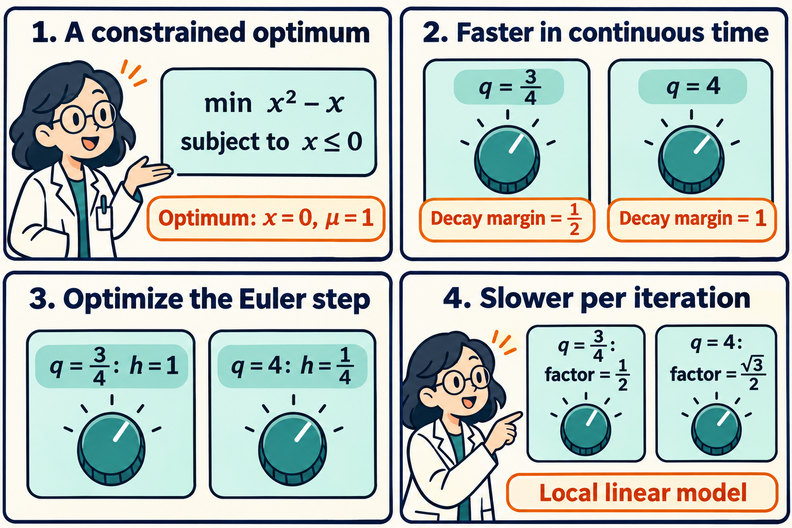

A continuous-time optimizer can look faster after a feedback gain increases, while its implementation needs more iterations. The gain changes both damping and oscillation. Once the integrator must resolve the oscillation, simulated time and computational work can move in opposite directions.

Kang Liu and Jianchen Hu's *Fischer–Burmeister-based Multiplier Dynamics in Inequality-Constrained Optimization*, first public on November 2, studies proportional–integral feedback driven by a complementarity residual. For constraint value $$g$$ and multiplier $$\mu$$, the residual is $$\Phi=\sqrt{\mu^2+g^2}-\mu+g$$. Its zero set encodes feasibility, nonnegative multipliers, and complementarity. The authors derive an explicit realization and analyze local stability, decay margins, and discretization costs. Their global results impose additional convexity and constraint geometry assumptions. [Full paper, Sections I–IV](https://arxiv.org/html/2611.02991v1).

The following original scalar example makes the computational tradeoff exact. Consider minimizing $$f(x)=x^2-x$$ subject to $$x\leq0$$. On the feasible half-line, the objective decreases toward the boundary, giving the unique optimum $$x^\star=0$$. Stationarity of the Lagrangian requires $$2x-1+\mu=0$$, so $$\mu^\star=1$$. The active constraint has a strictly positive multiplier.

Set the proportional gain to zero and the integral gain to $$q>0$$. The dynamics become

$$
\dot x=1-2x-\mu,\qquad
\dot\mu=q\bigl(\sqrt{\mu^2+x^2}-\mu+x\bigr).
$$

At the optimum, the residual's derivative with respect to $$x$$ is 1 and its derivative with respect to $$\mu$$ is 0. For perturbations $$u=x$$ and $$v=\mu-1$$, the local linear model is therefore

$$
\frac{d}{dt}\begin{pmatrix}u\\v\end{pmatrix}
=A_q\begin{pmatrix}u\\v\end{pmatrix},
\qquad A_q=\begin{pmatrix}-2&-1\\q&0\end{pmatrix}.
$$

This linearization applies near the strictly complementary equilibrium. The nonlinear residual is smooth there. It retains higher-order terms away from that point.

The characteristic equation is $$\lambda^2+2\lambda+q=0$$. For $$0<q<1$$, the eigenvalues are $$-1\pm\sqrt{1-q}$$, and the slow spectral decay margin is $$1-\sqrt{1-q}$$. For $$q>1$$, the roots are $$-1\pm i\sqrt{q-1}$$. Their real parts stay at −1 as the oscillation frequency grows.

Choose two gains. At $$q=3/4$$, the eigenvalues are $$-1/2$$ and $$-3/2$$, giving margin $$1/2$$. At $$q=4$$, they are $$-1\pm i\sqrt3$$, giving margin 1. The continuous-time spectral exponent has doubled.

Now implement the linear model with simultaneous explicit Euler updates and a positive constant step size $$h$$. Each eigenvalue becomes $$1+h\lambda$$. Stability requires every transformed eigenvalue to lie strictly inside the unit circle. The spectral radius $$r_q(h)$$ determines asymptotic modal decay per iteration.

For $$q=3/4$$,

$$
r_{3/4}(h)=\max\{\lvert1-h/2\rvert,\lvert1-3h/2\rvert\}.
$$

The two endpoint magnitudes balance at $$h=1$$, giving $$r_{3/4}(1)=1/2$$. This is the optimum over all positive constant Euler steps. Indeed, if $$h<1$$, the first magnitude exceeds $$1/2$$. If $$h>1$$, the second does. The full stable interval is $$0<h<4/3$$.

For $$q=4$$, the transformed eigenvalues are $$1-h\pm i\sqrt3h$$. Their squared magnitude is

$$
r_4(h)^2=(1-h)^2+3h^2
=4(h-1/4)^2+3/4.
$$

Thus the best step is $$h=1/4$$ and the best spectral factor is $$\sqrt3/2\approx0.866$$. Stability allows only $$0<h<1/2$$. Even after separately optimizing the Euler step for each gain, the larger gain gives slower asymptotic convergence per iteration.

The comic compares the same objective and equilibrium at two gains. Its final factors describe the local Euler spectrum. For a pure eigenmode, a millionfold reduction in amplitude takes 20 iterations at factor $$1/2$$ and 97 at factor $$\sqrt3/2$$. Arbitrary initial errors combine modes and can have different transients. These matrices need not shrink the Euclidean error norm by their spectral radius at every step.

There is a wider pattern in this example. For every $$q>1$$, minimizing $$1-2h+qh^2$$ gives $$h=1/q$$ and the best Euler factor $$\sqrt{1-1/q}$$. That factor approaches 1 as the gain grows, while the continuous-time spectral margin stays at 1. Eliminating $$v$$ from the linear equations gives $$\ddot u+2\dot u+qu=0$$. The damping coefficient stays fixed while the restoring coefficient increases. Faster oscillation forces smaller explicit steps.

At the critical gain $$q=1$$, the best Euler step is $$h=1$$. Its update matrix is

$$
I+A_1=\begin{pmatrix}-1&-1\\1&1\end{pmatrix},
\qquad (I+A_1)^2=0.
$$

The linear perturbation vanishes after two updates. The matrix has spectral radius zero but is itself nonzero, so a general initial perturbation survives the first update. The nonlinear Euler map still contains higher-order terms. The two-step identity describes its linearization.

The paper's broader analysis includes tangent–normal coupling, which changes how a continuous rate ceiling is approached. In our scalar example there are no tangent variables, and the spectral margin reaches its ceiling at a finite gain. For coupled cases the authors identify regimes with an asymptotic ceiling and a shrinking Euler stability limit. [Theorem 3 and Appendix B.5](https://arxiv.org/html/2611.02991v1#S3.SS3).

For constrained learning, this suggests judging a gain together with the update rule that will use it. A training budget counts gradient and constraint evaluations. A larger continuous-time exponent can be a poor predictor of that budget when the gain also creates fast modes. The exact comparison here fixes the objective, proportional gain, coordinate system, and Euler family, then optimizes only its constant step. Other integration schemes have their own stability regions and costs.

Strict complementarity makes the local derivatives available. A zero active multiplier would require handling the residual's singular pair. Likewise, a stable Euler Jacobian gives a local convergence statement, with a neighborhood and a prefactor, rather than a global guarantee for arbitrary initialization. The paper proves the nonlinear local result using factors strictly above the spectral radius. [Appendix E.5](https://arxiv.org/html/2611.02991v1#A5.SS5).

The comic was created with AI.
