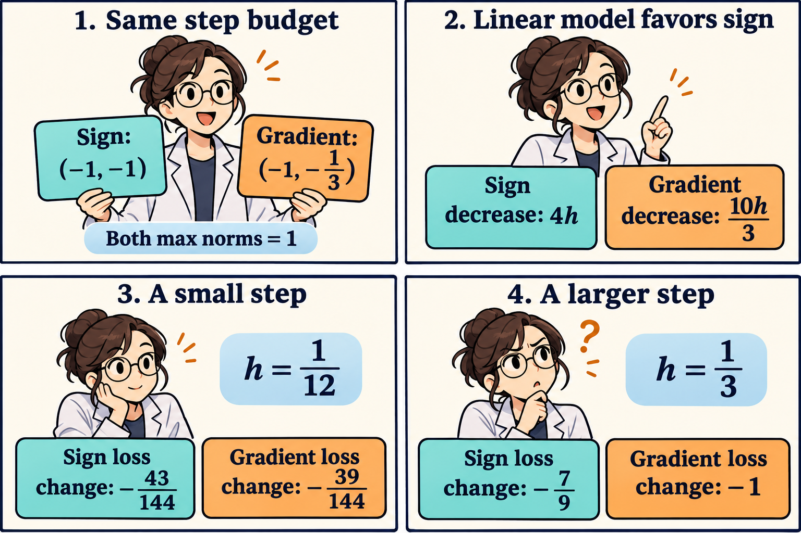

The word *steepest* needs a distance budget. Under a limit on the largest coordinate change, moving every coordinate against its gradient sign gives the best linear prediction. Curvature still determines how far that direction can travel profitably.

Bowen Li, Danqing Zhou, and Chuan He's *A simple adaptive accelerated optimistic dual averaging method for unconstrained convex optimization in p-norm geometry*, first public on November 3, combines norm-based directions with adaptive regularization and weighted averaging. It assumes a differentiable convex objective attaining its minimum and a generalized local smoothness condition. [Full paper and Assumption 1](https://arxiv.org/html/2611.05334v1).

Consider the following original geometry example. Let

$$
F(x)=\frac12(x_1^2+9x_2^2),\qquad
x=(3,1/9),\qquad \nabla F(x)=(3,1).
$$

The objective is strictly convex, its minimum is zero, and its current value is $$41/9$$. The second coordinate has nine times the curvature of the first, even though its current gradient is smaller.

A unit maximum-norm budget means $$\|d\|_\infty=\max_i\lvert d_i\rvert\leq1$$. For gradient vector $$g$$, Hölder's inequality gives $$g^\top d\geq-\|g\|_1$$. Equality holds by choosing each nonzero coordinate of $$d$$ opposite to the corresponding gradient sign. Here the sign direction $$d_s=(-1,-1)$$ predicts a loss change of $$-4h$$ for step length $$h>0$$.

For comparison, normalize the negative gradient to the same maximum norm. This gives $$d_g=(-1,-1/3)$$, with predicted change $$-10h/3$$. Both steps $$hd_s$$ and $$hd_g$$ have maximum norm exactly $$h$$. The sign direction therefore wins the linear comparison under an identical budget.

For a quadratic, the actual change is available exactly:

$$
F(x+hd)-F(x)
=h\,g^\top d+\frac{h^2}{2}d^\top
\begin{pmatrix}1&0\\0&9\end{pmatrix}d.
$$

Substitution yields

$$
\Delta_s(h)=-4h+5h^2,\qquad
\Delta_g(h)=-\frac{10}{3}h+h^2.
$$

The sign direction gains more from the linear term but pays five times as much in the quadratic term. Subtracting gives

$$
\Delta_s(h)-\Delta_g(h)
=4h^2-\frac23h=4h(h-1/6).
$$

Thus the sign step produces a lower loss for $$0<h<1/6$$. At $$h=1/6$$ the losses agree. For $$h>1/6$$ the normalized gradient direction gives the lower loss.

At $$h=1/12$$, the changes are $$-43/144$$ for the sign direction and $$-39/144$$ for the normalized gradient. The sign step is better by $$1/36$$. At $$h=1/3$$, the changes are $$-7/9$$ and $$-1$$, respectively. The normalized gradient step is better by $$2/9$$. All four steps lower the objective, so the preference reverses while both choices still make progress.

The comic's small-step panel uses the interval where the linear advantage dominates. Its larger-step panel crosses the exact threshold. Negative loss changes denote improvement, with the more negative value giving the larger reduction.

We can see the curvature cost directly from the second coordinate. The sign step changes it by $$-h$$, whereas the normalized gradient changes it by $$-h/3$$. Its quadratic cost is therefore $$9h^2/2$$ for the first direction and $$h^2/2$$ for the second. Both directions spend the same first-coordinate budget. Their difference is concentrated in how aggressively they move along the high-curvature coordinate.

The geometry also determines a uniform curvature bound. Since $$d_1^2+9d_2^2\leq10\|d\|_\infty^2$$, every step with maximum norm at most $$h$$ has a quadratic cost at most $$5h^2$$. The sign direction attains that bound here. The normalized gradient incurs only $$h^2$$. A common smoothness constant can consequently hide a large difference between the curvature actually encountered by two directions.

This illustrates one reason to couple geometry with an adaptive scale. The paper's dual map at the infinity-norm endpoint is $$J_1(g)=\|g\|_1\operatorname{sgn}_0(g)$$, selecting zero at zero coordinates. For $$g=(3,1)$$, it equals $$(4,4)$$. Our unit sign direction absorbs that magnitude into its step scale.

The full algorithm applies this map to a predicted accumulated gradient and evaluates new gradients at weighted averages. Its regularization update uses an aggregated affine model and a radius-corrected comparison. Main iterations avoid line searches, with optional initialization backtracking. [Sections 3.1–3.4](https://arxiv.org/html/2611.05334v1#S3).

The two directions in this note isolate the geometry of a single current gradient. A complete trajectory would also change that gradient, its history, the average point, and the regularization. The crossover establishes a scale-dependent preference for these two candidates at one point.

Under ordinary local smoothness, the paper's objective-gap exponent is $$1+2/p$$, giving 2 at $$p=2$$ and 1 at $$p=\infty$$. Gap-dependent curvature contributes a separate term. [Theorem 2](https://arxiv.org/html/2611.05334v1#S4).

Those exponents describe worst-case guarantees in their respective geometries. To assess a geometry on a particular learning problem, its curvature constants and distance to a solution also enter the bound. In this example, the maximum-norm smoothness constant is 10, and the Euclidean one is 9. The norms also measure the starting point differently. Comparing only the label *accelerated*, or only an exponent, would omit those quantities.

A concrete experiment suggested by the calculation would hold the maximum coordinate displacement fixed, measure each direction's linear prediction and actual quadratic cost, and repeat at several scales. For stochastic training, gradient noise and how often signs change would add separate effects. The deterministic convex calculation supplies an exact diagnostic for direction and scale, while leaving those trajectory questions open.

The comic was created with AI.
