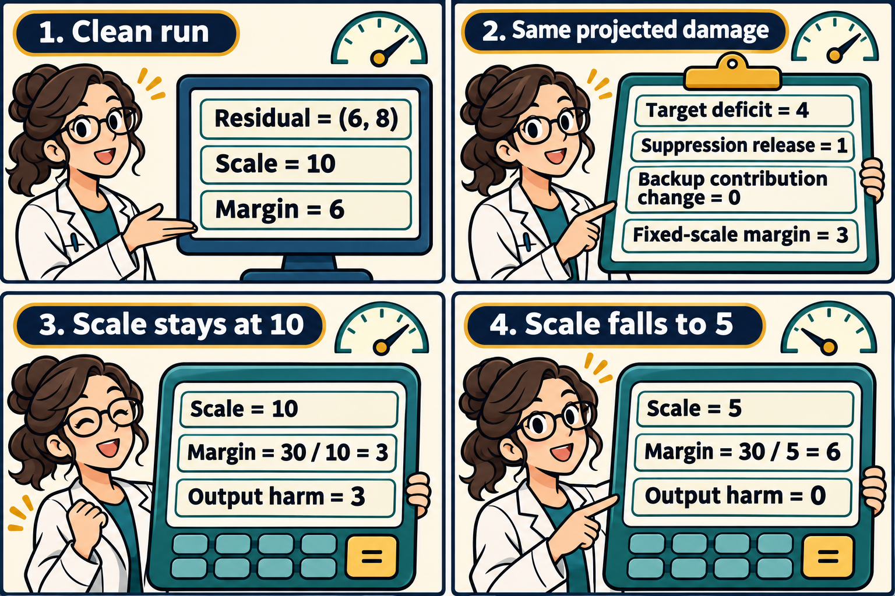

A component can lose much of its contribution while the output score barely moves. Other components may respond, and the normalization at the readout can amplify what remains. A comparison of final scores combines these effects.

Gautam Gupta and colleagues study this problem in *When Bigger Becomes Brittle: Why Compression Hurts More as Language Models Scale*, first submitted November 5. Their retrieval score is the correct name's logit minus the repeated subject's logit. They project component outputs onto that logit difference using the same clean normalization scale before and after intervention. [Paper and accounting setup](https://arxiv.org/html/2611.07891v1#S3).

Let $$D$$ be the target contribution lost, $$R$$ the signed change from copy suppression heads, and $$B$$ the signed change from the remaining components. All three use the clean scale. Let $$H=m_{\rm clean}-m_{\rm int}$$ be the actual margin drop. Define $$N$$ as the change in the margin left over after subtracting the contributions evaluated at the clean scale. Then the change in the margin is the sum of the projected changes and this remainder:

$$
\Delta m=-D+R+B+N,\qquad
H=D-R-B-N.
$$

The identity follows by adding and subtracting the fixed-scale sum. Each term can be inspected under the specified readout convention. The reported measurements have small reconstruction residuals. [Equation 1 and reconstruction details](https://arxiv.org/html/2611.07891v1#S3.E1). [Appendix A](https://arxiv.org/html/2611.07891v1#A1.SS0.SSS0.Px12).

Use the simplified radial readout $$m(r)=10r_1/\|r\|_2$$ for a nonzero two-coordinate residual $$r$$. In this example, the clean residual sums a target vector $$t=(4,0)$$, a suppression vector $$c=(-1,0)$$, and a remaining component $$o=(3,8)$$. Thus

$$
r_{\rm clean}=(6,8),\qquad
s_{\rm clean}=\sqrt{6^2+8^2}=10,\qquad
m_{\rm clean}=6.
$$

With the scale held at 10, the contribution of any vector $$w$$ is $$10w_1/10=w_1$$. The three clean contributions are 4, −1, and 3. Removing the target contribution from this sum alone gives a frozen-response reference of 2. If we instead removed the target vector and recomputed the norm of the remaining $$(2,8)$$, the readout would be $$20/\sqrt{68}$$. Fixing the scale is part of the reference calculation.

In both example interventions, the target vector is zeroed. Specify the ensuing suppression response as $$c_{\rm int}=(0,0)$$ and the other component as $$o_{\rm int}=(3,b)$$. Its first coordinate stays at 3. The ledger at the clean scale is identical for every $$b$$:

$$
D=4,\qquad R=1,\qquad B=0,\qquad
m_{\rm fixed}=6-4+1+0=3.
$$

The actual residual is $$(3,b)$$. Changing $$b$$ affects the denominator despite its zero projection onto the first coordinate. The clean readout equals the clean attribution sum, so the change in the remainder is just the intervened readout minus the fixed-scale margin. Therefore

$$
m_{\rm int}(b)=\frac{30}{\sqrt{9+b^2}},\qquad
N(b)=m_{\rm int}(b)-3,\qquad
H(b)=6-m_{\rm int}(b).
$$

- **Scale stays at 10.** Set $$b=\sqrt{91}$$. The norm is $$\sqrt{9+91}=10$$, the output margin is 3, and $$N=0$$. The identity gives $$H=4-1-0-0=3$$.
- **Scale falls to 5.** Set $$b=4$$. The norm is $$\sqrt{9+16}=5$$, the output margin is 6, and $$N=3$$. The identity gives $$H=4-1-0-3=0$$.

The bottom panels use the same numerator of 30. In the smaller-scale case, the entire residual has become half of its clean value, and the radial readout is invariant to positive rescaling. The example retains a target deficit of four despite the identical clean and intervened margins.

The margin drops when $$\lvert b\rvert>4$$. At $$\lvert b\rvert=\sqrt{91}$$, the normalization remainder vanishes. Between those thresholds, the remainder is positive and the output drop lies between zero and three. Beyond the second threshold the denominator pushes the output drop above three.

In the paper's exploratory Pythia sweeps, interpolation to a shared deficit of 0.5 logits gives about −0.05 logits of output harm at 410M and 0.38 at 12B. Separate held-out interventions test comparable damage and clamp selected responders. These measurements concern templated retrieval and specified ablations or simulated compression. [Section 3.2](https://arxiv.org/html/2611.07891v1#S3.SS2). [Held-out interventions](https://arxiv.org/html/2611.07891v1#A3.SS3).

Matching a projected deficit controls one scalar. The example shows how the residual can still move in directions that alter the readout scale, including changes that contribute zero to $$B$$. For a compression comparison, I would record both the fixed-scale and actual margin, alongside the norm change, at matched deficits on held-out prompts. An intervention that holds a component's response fixed would test its effect through downstream computation. Measuring the deficit again after that intervention would reveal whether the comparison also changed the initial amount of damage.

The comic was created with AI.
