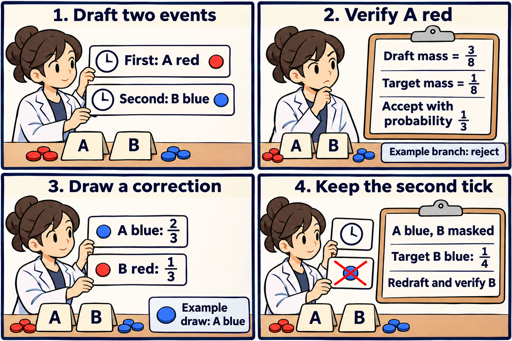

A masked language model fills positions in a partially completed sequence. One new token can change the distribution of the next, even when the next event's time has already been sampled. That distinction lets a speculative sampler batch expensive model evaluations while preserving the reference process.

Kasa, Dai, Negi, and Li's *SpecCTMC*, first submitted November 5, targets the continuous-time Markov chain induced by a masked denoiser. A mark is a pair consisting of a masked position and a replacement token. Each event permanently fills one position. The method verifies a tentative sequence of marks against the target model, commits a correction at the first rejection, and discards the remaining draft. [Paper, Sections 3–5](https://arxiv.org/html/2611.08362v1).

For the paper's linear masking schedule, take model time $$t$$ to run downward from 1 to a positive cutoff. Each of the $$m$$ remaining positions has unmasking rate $$1/t$$, divided among tokens according to its normalized probabilities. Summing the rates gives exit intensity $$m/t$$. The chance of traversing the interval down to $$u<t$$ with no event is

$$
\exp\left(-\int_u^t\frac{m}{s}\,ds\right)=(u/t)^m.
$$

This gives the next tick as $$t\exp(-E/m)$$ for a unit exponential draw $$E$$. In the coordinate $$-\log t$$, the waiting time is exponential with rate $$m$$. Every valid mark decrements $$m$$ by one, so a corrected token or position leaves the next clock law intact. The mark probabilities can still depend on the realized time. [Event clock and proof](https://arxiv.org/html/2611.08362v1#A2.SS3).

Take two remaining positions, A and B, and two possible tokens, red and blue. For an illustrative clock realization, $$E_1=2\log 2$$ and $$E_2=\log 2$$ give ticks at $$1/2$$ and $$1/4$$. Choose a cutoff below $$1/4$$. The first event removes one mask, and the second removes the last.

In order A red, A blue, B red, B blue, give the first event these illustrative draft and target probabilities:

$$
D=(3,1,1,3)/8,\qquad P=(1,3,2,2)/8.
$$

Both choose each position with probability one half. The token probabilities differ, so matching the position marginal leaves a discrepancy in the joint mark. For a sampled mark $$z$$, accept with probability $$\min\{1,P(z)/D(z)\}$$. The unconditional mass contributed by accepted draws is $$\min\{P(z),D(z)\}$$. It is $$(1,1,1,2)/8$$ across the four marks, leaving rejection probability $$3/8$$.

On rejection, fill the mass still missing from the target. The missing mass is $$(0,2,1,0)/8$$. Divide it by $$3/8$$ to get the conditional correction law $$(0,2,1,0)/3$$. Multiplying this law by the rejection probability and adding the accepted mass gives

$$
(1,1,1,2)/8+(0,2,1,0)/8=(1,3,2,2)/8.
$$

The correction can replace the position as well as the token. Here B red receives some correction mass even on rejection of an A red proposal. The construction also covers a mark absent from the draft, since all its target mass then comes through the correction. [Acceptance and residual rules](https://arxiv.org/html/2611.08362v1#S4.E10).

The comic follows one branch. The draft proposes A red and then B blue. A red is accepted with probability $$1/3$$. In the branch shown it is rejected and the correction picks A blue. Conditional on the example clock, the probability of proposing A red, rejecting it, and correcting to A blue is $$(3/8)(2/3)(2/3)=1/6$$, with either value allowed for the unused second proposal.

Suppose the target probability of B blue at the second tick is $$3/4$$ after A red and $$1/4$$ after A blue. The old second verification row was evaluated on the tentative state with A red. The corrected context requires the A-blue row, while the tick stays at $$1/4$$. A fresh proposal may still use a B-blue probability of $$3/4$$. Verification then accepts blue with probability $$1/3$$ and routes all correction mass to red. The committed blue mass is exactly $$(3/4)(1/3)=1/4$$. Consequently the target probability of the ordered marks A blue followed by B blue is $$(3/8)(1/4)=3/32$$.

For the complete path proof, a reached row has an accepted prefix, so its tentative input is the committed state. Verification uses that row's exact target distribution. Causal proposals and fresh correction draws let the one-event identity compose conditional on the clock. A shared cutoff and completion rule then preserve the output distribution. [Theorem 1 and Appendix B.5](https://arxiv.org/html/2611.08362v1#A2.SS5).

The same example separates latency from work. Assume no target rows are cached and the first round evaluates both rows together. If the first mark is accepted, the round commits both events, even when the second needs correction. If the first is rejected, one new row is needed in a second round. The expected number of sequential calls is $$1+3/8=11/8$$, compared with two direct calls. Yet the expected number of evaluated rows is $$2+3/8=19/8$$. If a two-row call costs $$c$$ times a single-row call, expected target time is $$c+3/8$$ in single-call units. It beats two direct calls only when $$c<13/8$$, before drafting and verification overhead.

That distinction appears in the paper's measurements. In one 2,048-token B200 case, the reduction in sequential calls was about 3.97-fold and the wall-clock speed ratio was about 0.99. [Appendix D.3](https://arxiv.org/html/2611.08362v1#A4.SS3).

I would measure the cost of each candidate batch size and the distribution of accepted prefix lengths together. Longer drafts can look attractive when calls are counted and lose their advantage when discarded rows take comparable time to separate calls. I would also compare the probabilities returned by the batched verifier with single-row evaluation for representative contexts. Equality of those kernels is an exactness condition, and hardware timing and numerical agreement answer different questions. [Exactness conditions](https://arxiv.org/html/2611.08362v1#A2.SS1).

The comic was created with AI.
