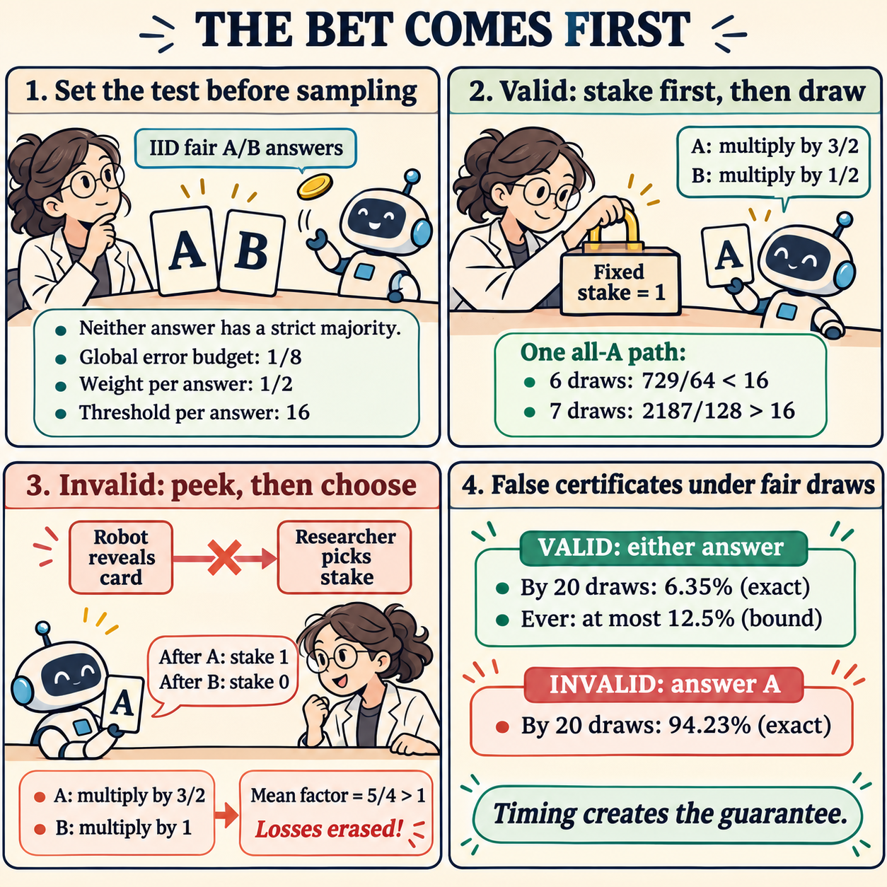

A stopping rule can look at every new answer without losing its statistical guarantee. The harder requirement is that the evidence must be constructed in the right order. If the current answer chooses its own stake, an apparently cautious test can become almost certain to announce a nonexistent majority.

Singh and Chowdhury's [*Sequential Anytime Valid Tests for Efficient Inference-Time Alignment*](https://arxiv.org/abs/2611.26413v1), public on November 19, tests whether an answer's sampling probability exceeds one half. [Theorem 1 and Appendix B](https://arxiv.org/html/2611.26413v1#A2.2) control false majority certificates across answers and times, assuming independent responses from a fixed generator and a fixed answer mapping. Each answer's process starts after discovery; the discovery response is excluded. Discovery-order weights sum to one. [Algorithm 2](https://arxiv.org/html/2611.26413v1#alg2) chooses stakes using past answers and rewards before drawing the next response. A budget fallback is not a certificate.

The following calculation is an original, simpler construction with two answers fixed **before** sampling. Its equal weights and first-draw initialization differ from the paper's discovery mechanism.

### Set up two tests before any response arrives

Let successive answers be independent draws from a fixed distribution on A and B. Write $$X_t=1$$ for A and $$X_t=0$$ for B, with $$\theta_A=\Pr(X_t=1)$$. The null hypothesis for A is $$\theta_A\leq 1/2$$. A certificate concerns frequency under this generator, not whether A is true.

Start A's evidence wealth at $$E_0^A=1$$ and update it by

$$
E_t^A=E_{t-1}^A
\left[1+\lambda_t\left(X_t-\frac12\right)\right],
\qquad 0\leq\lambda_t\leq1.
$$

The stake $$\lambda_t$$ must be determined from the history before draw $$t$$. This is the meaning of *predictable*. Conditional on that history, denoted $$\mathcal F_{t-1}$$,

$$
\mathbb E\!\left[
1+\lambda_t(X_t-\tfrac12)
\mid\mathcal F_{t-1}\right]
=1+\lambda_t(\theta_A-\tfrac12)\leq1.
$$

Every factor is at least one half. Thus wealth stays nonnegative and has no positive conditional drift under the null: it is a nonnegative supermartingale. Construct B's wealth in the same way, replacing $$X_t$$ by $$1-X_t$$.

Choose a global false-certificate budget $$\alpha=1/8$$ and preassign weights $$w_A=w_B=1/2$$. Each answer gets the threshold

$$
h=\frac{1}{\alpha w_A}=16.
$$

Why does this permit repeated checking? Let $$T_A$$ be the first time A's wealth reaches 16. For any finite horizon $$N$$, stopping the nonnegative supermartingale gives

$$
1\geq\mathbb E[E_{T_A\wedge N}^A]
\geq16\,\Pr(T_A\leq N).
$$

Letting $$N$$ increase proves $$\Pr(T_A<\infty)\leq1/16$$ under A's null. Apply the same reasoning to B and add the two error budgets. The probability of ever certifying any null answer is at most $$1/8$$. This argument does not require independence between the two wealth processes.

That is an unconditional error guarantee over repeated runs. It is not a statement that a certificate has at most a 12.5% chance of being false after conditioning on its existence.

### A valid path, and a tempting invalid shortcut

For the rest of the example, use a fair generator: A and B each have probability one half. Neither answer has a strict majority, so every certificate is false.

Fix the stake at one before every draw. For A's process, an A multiplies wealth by $$3/2$$; a B multiplies it by $$1/2$$. Along the particular path consisting entirely of A,

$$
E_6^A=\frac{729}{64}=11.390625<16,\qquad
E_7^A=\frac{2187}{128}=17.0859375>16.
$$

Seven is the crossing time on this one path. It is not a promised waiting time under fair sampling.

This fixed stake is convenient for arithmetic, not universally efficient. At an A-probability $$\theta_A$$, its expected log factor is

$$
g(\theta_A)=\theta_A\log3-\log2.
$$

Positive log growth requires $$\theta_A>\log2/\log3\approx0.63093$$. A small majority can therefore have negative log growth with this stake. Error control alone does not guarantee useful power.

Now deliberately violate predictability: inspect the current response, then set the stake to one if it is A and zero if it is B. Wealth gains a factor $$3/2$$ on A and a factor one on B. This rule erases every loss. Under the fair generator, its expected factor becomes

$$
\frac12\frac32+\frac12\cdot1=\frac54>1.
$$

The earlier conditional-expectation proof no longer applies because the stake depends on the same response it multiplies. After $$n$$ draws, the invalid A-wealth is

$$
\widetilde E_n^A=\left(\frac32\right)^{K_n},
\qquad K_n=\sum_{t=1}^n X_t.
$$

It crosses 16 as soon as seven A answers have appeared, however many B answers intervene. Consequently,

$$
\Pr(\widetilde T_A\leq20)
=2^{-20}\sum_{k=7}^{20}\binom{20}{k}
=\frac{247029}{262144}
\approx94.23\%.
$$

With unlimited independent fair draws, seven A answers eventually appear with probability one. The invalid rule therefore produces a false A-certificate almost surely.

### Compare the same finite horizon exactly

For the valid fixed-stake rule, wealth after $$n$$ responses containing $$k$$ A answers is

$$
E_n^A=\frac{3^k}{2^n},\qquad
E_n^B=\frac{3^{n-k}}{2^n}.
$$

Counting only the wealth at draw 20 would miss paths that crossed earlier and then fell. Instead, let $$s_n(k)$$ count length-$$n$$ answer strings with $$k$$ A answers for which neither process has crossed at any prefix. Initialize $$s_0(0)=1$$. The exact recursion is

$$
s_n(k)=
\begin{cases}
s_{n-1}(k)+s_{n-1}(k-1),
&\max(3^k,3^{n-k})<16\cdot2^n,\\
0,&\text{otherwise},
\end{cases}
$$

with out-of-range counts set to zero. Every retained string has probability $$2^{-n}$$, so the missing mass is precisely the first-crossing probability.

| Rule and event | Probability by 20 draws |
|---|---:|
| Valid fixed stake: A crosses | $$8327/262144\approx3.18\%$$ |
| Valid fixed stake: either answer crosses | $$8327/131072\approx6.35\%$$ |
| Invalid look-ahead: A crosses | $$247029/262144\approx94.23\%$$ |

The 6.35% entry is an exact finite-horizon probability. The 12.5% result is a conservative bound for either answer across **all** times. They answer different questions. The invalid entry tracks A alone; applying the loss-erasing trick to both answers would force a crossing by draw 13, since at least one answer must then have appeared seven times.

### What I would require from an implementation

The decisive audit trail is chronological: history available, stake fixed, new response drawn, wealth updated. Rewards may help choose a useful next stake. They cannot justify letting the current response rewrite its own stake while retaining the proof above.

A deployment that changes its generator during sampling needs a corresponding conditional-probability argument. Independent fair draws cannot silently be replaced by correlated or adaptively edited responses. Likewise, a changing equivalence rule for answer strings changes what the indicator measures.

Repeated inspection itself is harmless for the process proved here. Data reuse and an incorrect stake order are not. In a distributed implementation, delayed updates make that distinction particularly practical: a stake computed after a response arrives may still be valid for a later response, but not retroactively for the response that computed it.

Finally, a majority certificate does not establish correctness, and failing to cross a threshold does not prove that no majority exists. My research judgment is that such stopping methods should expose both the precise certified claim and an explicit uncertified outcome. Efficient stopping becomes useful only when those meanings survive the sampling pipeline.

*The comic's two-answer construction uses preassigned equal weights. Its seven-draw path includes the first draw; a process that begins only after discovery has a different count.*

The comic was created with AI.

