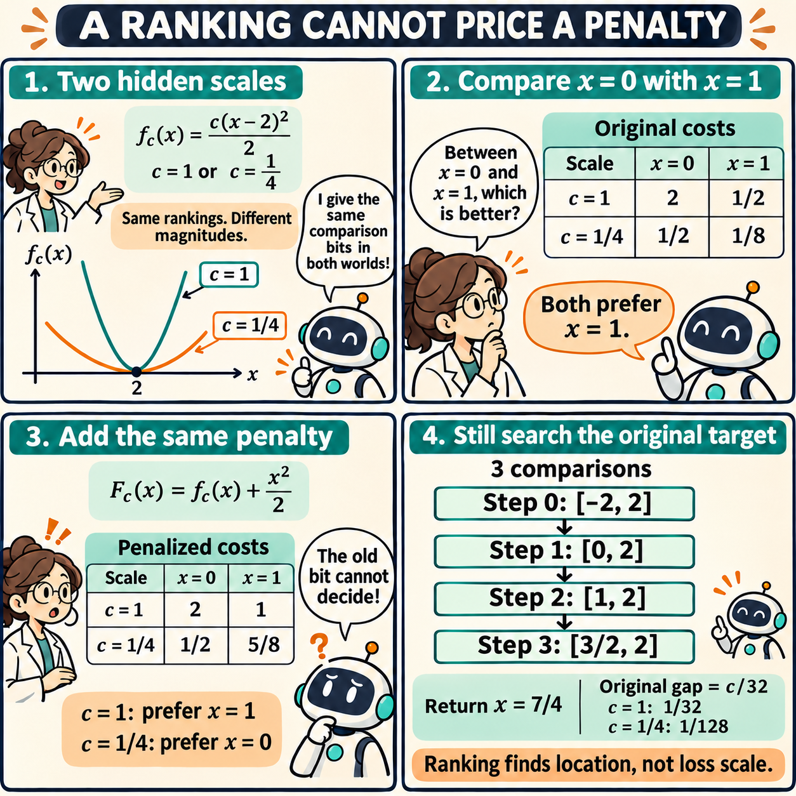

Comparisons reveal ordering, not magnitude. A fixed penalty can change that ordering.

Richtárik and Mahran's [*Near-Optimal Smooth Convex Optimization with a Comparison Oracle*](https://arxiv.org/abs/2611.29533v1) (November 22) studies globally smooth unconstrained convex objectives with known smoothness and initial-distance bounds $$L,R$$ and an attained minimizer. Under exact comparisons, [Theorem 3.4](https://arxiv.org/html/2611.29533v1#S3.Thmtheorem4) bounds calls by

$$
O\!\left(\sqrt A\,
[d\log(2dA)+\log^2(2A)]\right),
\qquad A=\frac{LR^2}{\varepsilon}\geq1,
$$

Here $$d$$ is dimension and $$\varepsilon$$ the target gap. [Algorithm 2](https://arxiv.org/html/2611.29533v1#alg2) estimates unit gradient directions and searches bounded ray segments and plane disks. Its horizon is prescribed. Lower bounds match up to logarithms for $$32\leq A\leq d^2$$. Exact real arithmetic is assumed; [Appendix F](https://arxiv.org/html/2611.29533v1#A6) requires a known uniform conditional advantage above one half for noisy replies.

Here is an original one-dimensional example of the information boundary, followed by a comparison-only search. It illustrates neither the full algorithm nor its high-dimensional complexity.

### Two indistinguishable scales

Consider the possible objectives

$$
f_c(x)=\frac c2(x-2)^2,\qquad
c\in\left\{1,\frac14\right\}.
$$

Both are convex and have minimizer $$x^\star=2$$. Both satisfy the same supplied bounds $$L=1$$ and $$R=2$$ from initial point zero. Here $$L$$ is a valid upper bound on curvature, not a promise that curvature equals one.

An oracle returns the bit

$$
b_c(u,v)=\mathbf1\{f_c(u)\geq f_c(v)\}.
$$

Since $$f_c=c f_1$$ with positive $$c$$, every possible comparison bit is identical in the two worlds. This also holds for an adaptive sequence: identical previous replies produce the same next query, which again receives the same reply. No number of such queries can distinguish these two scales.

For example, the objective values at zero and one are

$$
\begin{aligned}
(f_1(0),f_1(1))&=(2,\tfrac12),\\
(f_{1/4}(0),f_{1/4}(1))&=(\tfrac12,\tfrac18).
\end{aligned}
$$

Both prefer one. Yet their gradients at zero are $$-2$$ and $$-1/2$$. Direction is preserved; magnitude is hidden.

### A known penalty does not repair the missing information

Add the same known penalty to both possible objectives:

$$
F_{c,\mu}(x)=f_c(x)+\frac{\mu}{2}x^2,
\qquad \mu>0.
$$

For the fixed pair of candidates zero and one,

$$
F_{c,\mu}(0)-F_{c,\mu}(1)
=\frac{3c-\mu}{2}.
$$

The preference changes at $$c=\mu/3$$. Fix $$\mu=1$$ for the concrete calculation. Then

$$
\begin{aligned}
F_{1,1}(0)&=2>1=F_{1,1}(1),\\
F_{1/4,1}(0)&=\frac12<\frac58=F_{1/4,1}(1).
\end{aligned}
$$

The first world prefers one; the second prefers zero. An algorithm receiving only the original comparison transcript and the same bounds must behave identically in both worlds. It therefore cannot always answer this penalized comparison correctly.

This is a statement about a **pairwise comparison**, not a claim that zero minimizes the second penalized function. Differentiation gives

$$
\arg\min_x F_{c,\mu}(x)=\frac{2c}{c+\mu}.
$$

At the two chosen scales with unit penalty, the penalized minimizers are one and $$2/5$$.

The missing quantity is the original loss difference in the units of the penalty. Knowing the penalty difference alone is insufficient. If both the loss and penalty were multiplied by the same positive scale, their combined ordering would be preserved; holding the penalty fixed changes the tradeoff.

### The original target remains searchable

Indistinguishable scale does not make the original optimization problem impossible. Both worlds have the same original minimizer.

To make the search genuinely use only bits, suppose the center is also hidden. Consider the wider quadratic family

$$
q_{c,a}(x)=\frac c2(x-a)^2,\qquad
0<c\leq1,\quad a\in[-2,2].
$$

The routine knows the initial bracket, but not $$a$$ or $$c$$. Our earlier pair of objectives is the case $$a=2$$.

For a bracket midpoint $$m$$, compare $$q_{c,a}(m+h)$$ with $$q_{c,a}(m-h)$$ using any fixed $$h>0$$. Expanding the two squares gives

$$
q_{c,a}(m+h)-q_{c,a}(m-h)=2ch(m-a).
$$

Because $$2ch>0$$, the comparison tells which closed half contains the center. If the right probe has at least as large a value, retain the left half; otherwise retain the right half. A tie retains the center whichever half is chosen.

This identity is exact for this quadratic family. For a general smooth convex function, a finite centered comparison need not identify the derivative sign at the midpoint.

Use $$h=1/4$$. For our instance with center two, the midpoint probes at zero, one and $$3/2$$ all favor the right probe. Three comparisons therefore give

$$
[-2,2]\ \longrightarrow\ [0,2]\
\longrightarrow\ [1,2]\
\longrightarrow\ [3/2,2].
$$

Return the last bracket's midpoint, $$\widehat x=7/4$$. Its original gap is

$$
f_c(\widehat x)-f_c(2)
=\frac c2\left(\frac14\right)^2
=\frac c{32}.
$$

Thus the exact gaps are $$1/32$$ and $$1/128$$. These numbers describe the original losses, not the penalized ones.

More generally, after $$k$$ such halvings, the bracket width is $$4/2^k$$ and the midpoint is at most $$2/2^k$$ from the minimizer. The common smoothness bound gives

$$
q_{c,a}(\widehat x)-q_{c,a}(a)
\leq\frac12\left(\frac2{2^k}\right)^2
=\frac2{4^k}.
$$

Consequently, three comparisons suffice for gap at most $$1/32$$ throughout this quadratic family, without discovering the scale.

### What this changes in a learning system

If clients expose only preferences between models, a server cannot automatically insert a fixed distance penalty and keep using those preferences as though they compared the combined objective. It needs additional magnitude information, a comparator for the combined objective, or a method whose operations are justified by the available oracle.

The distinction also matters when evaluating efficiency. A comparison count measures information requests. It does not by itself bound numerical precision, communication latency, or the expense of obtaining each reliable comparison.

My research priority would be to measure how comparison reliability changes with the loss gap. A fixed error advantage across arbitrarily close values is a strong requirement. Repetition may help with fresh errors; a systematically repeated wrong answer needs a different argument.

The useful conclusion is precise: ordering can locate a target even when it cannot calibrate a new tradeoff. An optimizer should build its operations around the information it actually receives.

The comic was created with AI.

