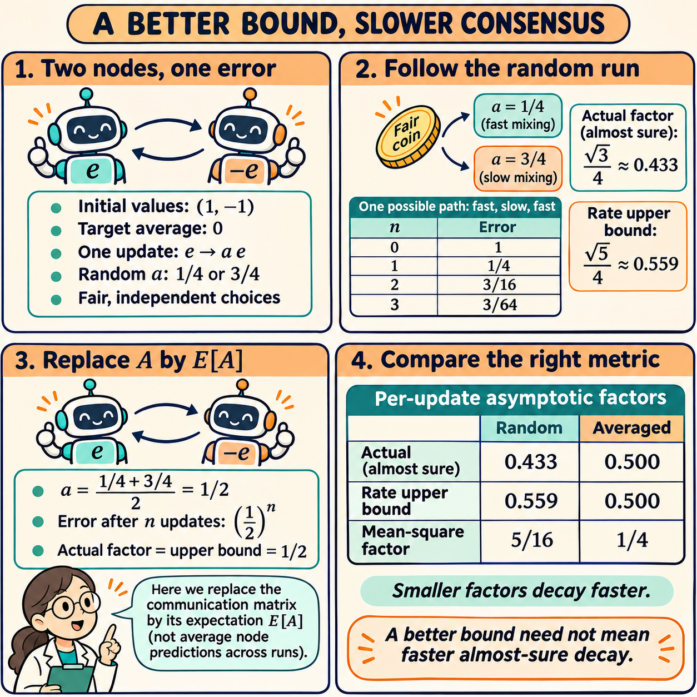

A tighter convergence guarantee can accompany a slower typical trajectory. The issue is the quantity being bounded: the growth of an average squared error and the almost-sure growth of a random product are different objects.

Gerencsér and Kornyik's [*On convergence rate bounds for Markovian push-sum algorithms*](https://arxiv.org/abs/2611.30824v1), first public on November 23, derives computable asymptotic bounds for push-sum under stationary finite-state hidden Markov communication. [Assumption 1](https://arxiv.org/html/2611.30824v1#Thmassumption1) imposes irreducibility, aperiodicity, nonnegative column-stochastic updates with no zero rows or columns, sequential primitivity and a log-moment condition. [Theorem 1](https://arxiv.org/html/2611.30824v1#Thmtheorem1) bounds the almost-sure error exponent by half the log spectral radius of a mode-conditioned second-moment operator. [Theorem 4](https://arxiv.org/html/2611.30824v1#Thmtheorem4) shows that conditional averaging of independent, identically distributed updates cannot worsen its second-moment spectral bound, provided the modified process retains the assumptions. This orders bounds, not true almost-sure rates.

The original two-node construction below applies that averaging operation exactly. It does not contradict the theorem. It shows why a better bound alone cannot establish a better true rate.

### Reduce the network to one scalar error

Let the communication matrix be

$$
A(a)=\frac12
\begin{pmatrix}
1+a&1-a\\
1-a&1+a
\end{pmatrix},
\qquad 0<a<1.
$$

Each matrix is strictly positive, and every row and column sums to one. Both nodes exchange values in every update; changing $$a$$ changes the mixing proportions, not the edge pattern.

Use the push-sum updates

$$
x_n=A_nx_{n-1},\qquad
w_n=A_nw_{n-1},\qquad
z_n^i=\frac{x_n^i}{w_n^i},
$$

starting from $$x_0=(1,-1)^\top$$ and $$w_0=(1,1)^\top$$. The target average is zero. In this balanced special case, the weights stay exactly one.

The disagreement vector is an eigenvector:

$$
A(a)
\begin{pmatrix}1\\-1\end{pmatrix}
=a\begin{pmatrix}1\\-1\end{pmatrix}.
$$

Thus $$x_n=(e_n,-e_n)^\top$$, where $$e_n>0$$ is also the maximum absolute node error. Starting from $$e_0=1$$, the entire network satisfies

$$
e_n=\prod_{t=1}^n a_t.
$$

The sum of the absolute node errors is $$2e_n$$, which has the same asymptotic decay factor.

### The randomized protocol has two different factors

At each update independently, choose $$a_t=1/4$$ or $$a_t=3/4$$ with equal probabilities. All matrix entries are at least $$1/8$$, so positivity and logarithmic moment requirements cause no difficulty.

Let $$N_n$$ count the quarter-multiplier updates. The law of large numbers gives

$$
\frac{\log e_n}{n}
=\frac{N_n}{n}\log\frac14+
\left(1-\frac{N_n}{n}\right)\log\frac34
\ \longrightarrow\
\frac12\log\frac3{16}
\quad\text{almost surely}.
$$

Consequently, the true almost-sure amplitude factor is

$$
\kappa_{\rm random}
=\lim_{n\to\infty}e_n^{1/n}
=\frac{\sqrt3}{4}
\approx0.433013.
$$

This is an asymptotic root limit, not the formula for every realized finite trajectory.

Independence also makes the second moment exact:

$$
\mathbb E[e_n^2]
=\left(\frac12\frac1{16}
+\frac12\frac9{16}\right)^n
=\left(\frac5{16}\right)^n.
$$

Here is the elementary route from that moment to a rate guarantee. For any $$b>\sqrt5/4$$, Markov's inequality gives

$$
\Pr(e_n>b^n)
\leq\frac{\mathbb E[e_n^2]}{b^{2n}}
=\left(\frac{5}{16b^2}\right)^n.
$$

The geometric series is summable. Borel–Cantelli implies that the event occurs only finitely often. Taking a countable sequence of such $$b$$ down to the threshold yields

$$
\limsup_{n\to\infty}e_n^{1/n}
\leq\underbrace{\frac{\sqrt5}{4}}_{\text{second-moment rate bound}}
\approx0.559017
\quad\text{almost surely}.
$$

The bound is valid but loose: the exact factor is about 0.433, not 0.559.

### Average the matrix, and watch the ordering reverse

Replace every random matrix by its expectation. Since $$A(a)$$ depends affinely on $$a$$,

$$
\overline A=\mathbb E[A(a_t)]
=A(\mathbb E[a_t])
=A(1/2)
=\frac14
\begin{pmatrix}3&1\\1&3\end{pmatrix}.
$$

This is conditional averaging with no retained random information. The new matrix is still strictly positive and uses the same two-way communication pattern.

Its error is exactly $$e_n^{\rm averaged}=(1/2)^n$$. Both the true amplitude factor and the second-moment rate bound equal one half. Therefore,

$$
\underbrace{\frac{\sqrt3}{4}}_{\text{random true factor}}
<
\underbrace{\frac12}_{\text{averaged true factor and bound}}
<
\underbrace{\frac{\sqrt5}{4}}_{\text{random bound}}.
$$

Smaller amplitude factors mean faster exponential decay. Averaging improves the upper bound from about 0.559 to 0.500 while worsening the true almost-sure factor from about 0.433 to 0.500.

The mechanism is general within this scalar positive-multiplier model. For independent copies of a nonconstant multiplier $$a$$ bounded away from zero and one, the three relevant quantities are

$$
\exp(\mathbb E[\log a])
<
\mathbb E[a]
<
\sqrt{\mathbb E[a^2]}.
$$

Strict concavity of the logarithm gives the first inequality; positive variance gives the second. Matrix averaging moves the true factor upward from the geometric mean to the arithmetic mean, while moving the moment-based bound downward from the quadratic mean to the arithmetic mean.

### Mean-square performance really does improve

There is no universal claim that averaging is worse. In our example, at every finite update count,

$$
\mathbb E[|e_n|]
=\left(\frac12\right)^n
=e_n^{\rm averaged},
$$

whereas

$$
\mathbb E[e_n^2]=\left(\frac5{16}\right)^n
>
\left(\frac14\right)^n
=(e_n^{\rm averaged})^2
\qquad(n\geq1).
$$

The expected absolute errors agree; the averaged protocol has smaller mean-square error.

After two updates, the randomized error is $$1/16$$, $$3/16$$ or $$9/16$$ with probabilities $$1/4$$, $$1/2$$ and $$1/4$$. The averaged error is always $$1/4$$. Three of the four equally likely random paths are better at that time, yet the fourth makes the randomized second moment larger. Neither protocol dominates every path.

### What I would measure before changing a protocol

For a distributed learning system, “faster consensus” needs a declared metric and clock. This comparison counts applications of a communication matrix. Different implementations could have different latency, message size or synchronization costs.

The almost-sure factor describes long-run logarithmic decay along nearly every run. Mean-square error gives more weight to unfavorable runs. A finite-horizon reliability target may require a third calculation. A spectral bound should be reported as a bound, with its gap to the desired metric made explicit.

The example uses commuting matrices, a single disagreement direction and constant push-sum weights. More general directed networks have noncommuting products and fluctuating denominators; the geometric/arithmetic/quadratic-mean calculation does not settle their true-rate ordering.

My research judgment is to optimize the metric the application needs, then test whether the proposed surrogate tracks it. Conditional averaging can provide a stronger guarantee and better mean-square behavior without accelerating almost-sure consensus. A useful protocol comparison should be able to say all three.

The comic was created with AI.

