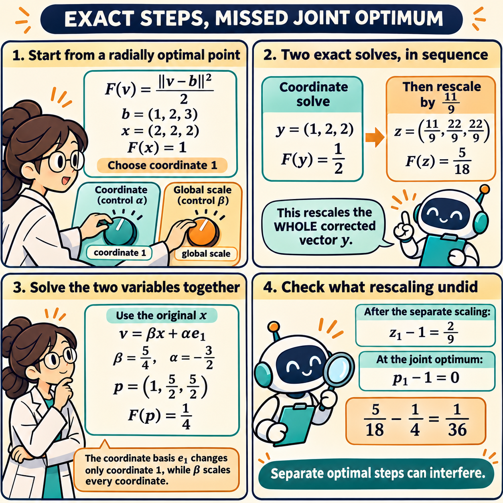

Two exact scalar solves can leave a gap to the joint optimum.

Rusu's [*Scaled Coordinate Descent for Convex Quadratic Programs*](https://arxiv.org/abs/2611.34123v1), first public on November 25, studies unconstrained symmetric positive definite quadratics. [Propositions 1–2](https://arxiv.org/html/2611.34123v1#Thmproposition1) jointly optimize a coordinate correction and a scaling of the current iterate. [Algorithm 1](https://arxiv.org/html/2611.34123v1#alg1) also includes a coordinate-then-rescale safeguard. The [randomized exact-step analysis](https://arxiv.org/html/2611.34123v1#Thmproposition7) treats the joint update. The paper explicitly distinguishes these maps; the following numerical witness and completed-square calculation are an original illustration.

### Start with no remaining radial improvement

Use the Euclidean quadratic

$$
F(v)=\frac12\Vert v-b\Vert_2^2,\qquad
b=(1,2,3)^\top,\qquad
x=(2,2,2)^\top.
$$

Its global minimizer is $$b$$, with value zero, so every displayed value of $$F$$ is also an objective gap. The initial gap is $$F(x)=1$$.

This starting point is already optimal under pure scaling. Indeed,

$$
\arg\min_{\beta\in\mathbb R}F(\beta x)
=\frac{b^\top x}{x^\top x}
=\frac{12}{12}=1.
$$

Equivalently, the gradient $$g(x)=x-b=(1,0,-1)^\top$$ is orthogonal to $$x$$. We select coordinate one, with basis vector $$e_1=(1,0,0)^\top$$.

### First solve the coordinate, then solve the scale

Holding the other two coordinates fixed, the exact coordinate minimizer is

$$
y=x-e_1=(1,2,2)^\top,\qquad F(y)=\frac12.
$$

At this point, the first gradient component is zero.

Now minimize over the radial line through the **corrected** vector $$y$$. Its exact scale is

$$
\beta^\dagger
=\frac{b^\top y}{y^\top y}
=\frac{1+4+6}{1+4+4}
=\frac{11}{9}.
$$

The resulting point and gap are

$$
z=\beta^\dagger y
=\left(\frac{11}{9},\frac{22}{9},\frac{22}{9}\right)^\top,
\qquad
F(z)=\frac12\left[
\left(\frac29\right)^2+
\left(\frac49\right)^2+
\left(-\frac59\right)^2\right]
=\frac5{18}.
$$

Both scalar minimizations were exact. The radial solve improved the gap from one half to five eighteenths. Nevertheless, it moved coordinate one away from its coordinate optimum:

$$
g_1(z)=z_1-b_1=\frac29.
$$

The radial condition still holds: $$z^\top g(z)=0$$. Satisfying it does not also make the coordinate condition hold.

### Solve both coefficients together

The joint update uses the original iterate $$x$$:

$$
v=\beta x+\alpha e_1
=(2\beta+\alpha,2\beta,2\beta)^\top.
$$

This plane permits the first coordinate to change independently of the common value of coordinates two and three. Its objective is

$$
F(\beta x+\alpha e_1)
=\frac12\left[
(2\beta+\alpha-1)^2+
(2\beta-2)^2+
(2\beta-3)^2\right].
$$

For each fixed $$\beta$$, minimizing over $$\alpha$$ gives $$\alpha=1-2\beta$$. The remaining two squared residuals balance at $$2\beta=5/2$$. Therefore,

$$
\beta^\star=\frac54,\qquad
\alpha^\star=-\frac32,\qquad
p=\left(1,\frac52,\frac52\right)^\top,
\qquad F(p)=\frac14.
$$

This is the unique minimizer in the selected plane. It is not the global minimizer: every point in this plane has equal second and third coordinates, whereas $$b_2\ne b_3$$.

The two necessary directional conditions now hold simultaneously:

$$
e_1^\top g(p)=0,\qquad
x^\top g(p)=0.
$$

Since $$p$$ is a linear combination of these directions, $$p^\top g(p)=0$$ as well.

### Complete the square to account for every missing fraction

The entire difference can be read from an exact identity:

$$
F(\beta x+\alpha e_1)
=\frac14+
\frac12(\alpha+2\beta-1)^2+
4\left(\beta-\frac54\right)^2.
$$

The joint solver makes both extra terms vanish. The sequential result has coefficients $$\beta=11/9$$ and $$\alpha=-11/9$$ relative to the original basis, because $$z=(11/9)(x-e_1)$$. Substitution gives

$$
F(z)-F(p)
=\frac12\left(\frac29\right)^2
+4\left(-\frac1{36}\right)^2
=\frac{2}{81}+\frac1{324}
=\frac1{36}.
$$

Nothing here comes from rounding or an inexact line search. After choosing the first correction, the sequential method searches only the line through $$y$$. The joint method remains free to choose the two coefficients independently.

Even though the objective has identity Hessian in the original coordinates, the search directions are not orthogonal. Their Gram matrix, in coefficient order $$\alpha,\beta$$, is

$$
G=
\begin{pmatrix}
e_1^\top e_1&e_1^\top x\\
x^\top e_1&x^\top x
\end{pmatrix}
=
\begin{pmatrix}1&2\\2&12\end{pmatrix}.
$$

Its determinant is eight, so the coefficient problem is strictly convex. The nonzero off-diagonal entry is precisely the coupling. A separable objective can become coupled when expressed in a nonorthogonal search basis.

### One pass is different from repeated passes

The calculation concerns one coordinate solve and one radial solve. It does not establish a failure of repeated alternation.

In this example, after each complete sequential pass the vector has form $$(r,q,q)^\top$$. The next coordinate solve first restores coordinate one to one, and the next radial solve changes the common value by

$$
q^+=\frac{q(1+5q)}{1+2q^2},
\qquad
q^+-\frac52=\frac{q-\frac52}{1+2q^2}.
$$

Starting with $$q=22/9$$ after the first pass, successive values approach $$5/2$$; the first coordinate approaches one. Additional passes recover progress that the first pass left behind.

### What I would require from a practical comparison

For least-squares and quadratic subproblems, I would identify the intended search space before choosing the local solver. An exact plane step should leave the gradient orthogonal to every independent basis direction. Checking radial orthogonality alone misses the residual exposed here.

Compare elapsed time as well as objective decrease when judging either update.

Here the normalized Gram condition number is $$2+\sqrt3$$; practical safeguards need guarantees for their actual update.

My research judgment is to keep search-space design, subproblem accuracy and numerical safeguards explicit. The useful distinction is not whether each scalar operation was exact. It is whether their composition satisfied the optimality conditions of the problem that was meant to be solved.

The comic was created with AI.

