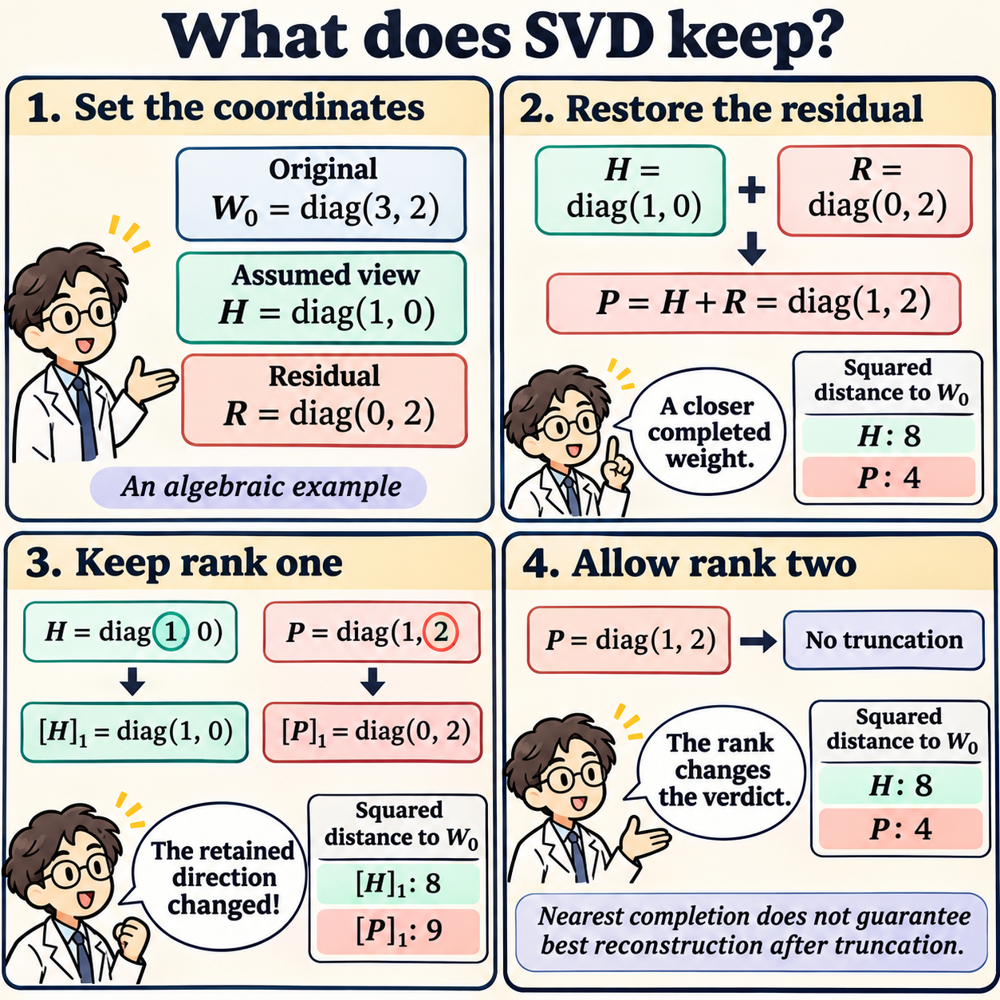

A weight matrix can move closer to its teacher while its truncated version moves farther away.

Fang, Mishin, and Falsafi's [*Learning to Be Truncated: Preparing LLM Checkpoints for SVD Compression*](https://arxiv.org/abs/2611.34667v1), first public November 25, introduces LLift. [Section 4](https://arxiv.org/html/2611.34667v1#S4) distills a fixed-basis low-rank student with student-to-teacher KL, also adapting embeddings, the head, and norms. Export restores the original complement. [Appendices A.1–A.2](https://arxiv.org/html/2611.34667v1#A1.SS1) distinguish minimum Frobenius change from recompression error, without universal task guarantees.

### An original example: fix coordinates, then complete

Let $$W_0$$ be the original weight and $$Q$$ have orthonormal columns. Write

$$
B_0=Q^\top W_0,\qquad R_0=(I-QQ^\top)W_0,
\qquad W_0=QB_0+R_0.
$$

For prescribed coordinates $$B$$, compare $$H=QB$$ with its completion $$P=QB+R_0$$. Here $$P$$ denotes a weight matrix, not a projector.

Use a deliberately small example:

$$
W_0=\begin{pmatrix}3&0\\0&2\end{pmatrix},\qquad
Q=\begin{pmatrix}1\\0\end{pmatrix},\qquad B_s=(s,0),\qquad s>0.
$$

The preparation direction is consistent with the leading left singular vector of $$W_0$$. Then

$$
H_s=\operatorname{diag}(s,0),\qquad
R_0=\operatorname{diag}(0,2),\qquad
P_s=\operatorname{diag}(s,2).
$$

The assumed $$s$$ need not result from LLift training. Indeed, minimizing the isolated squared error $$\Vert W_0-QB\Vert_F^2$$ would retain $$B=(3,0)$$. Distillation with adapting surrounding parameters solves a different problem.

Any matrix satisfying $$Q^\top W=B_s$$ has the form

$$
W=\begin{pmatrix}s&0\\u&v\end{pmatrix},\qquad
\Vert W-W_0\Vert_F^2=(s-3)^2+u^2+(v-2)^2.
$$

Thus the unique closest completion has $$u=0,v=2$$: it is exactly $$P_s$$. Setting the second row to zero instead incurs an extra squared error of four. At $$s=1$$,

$$
\Vert P_1-W_0\Vert_F^2=4,
\qquad \Vert H_1-W_0\Vert_F^2=8.
$$

This completion claim is fully satisfied before any deployment truncation occurs.

### Now keep only one singular direction

Let $$[A]_1$$ denote the best rank-at-most-one approximation to $$A$$ in Frobenius norm, and define teacher reconstruction error

$$
E(Y)=\Vert W_0-Y\Vert_F^2.
$$

At $$s=1$$, the sole nonzero singular value of $$H_1$$ is one. Its rank-one truncation changes nothing. The completed matrix $$P_1$$ has singular values two and one, so its best rank-one approximation keeps the second coordinate instead:

$$
[H_1]_1=\operatorname{diag}(1,0),\qquad
[P_1]_1=\operatorname{diag}(0,2).
$$

The errors are

$$
E([H_1]_1)=(3-1)^2+2^2=8,
\qquad E([P_1]_1)=3^2+(2-2)^2=9.
$$

SVD still solves its stated problem: approximating $$P_1$$. Its squared error to that matrix is one, compared with four if it kept $$H_1$$. But the evaluation target above is $$W_0$$. Optimality for one target does not order errors to another.

*All errors in the comic are squared Frobenius distances to the original weight. The adapted coordinates are assumed for this algebraic example.*

### The reversal occupies an interval

For every $$0<s<2$$, the restored second singular direction wins. Hence

$$
E([P_s]_1)-E([H_s]_1)
=9-\bigl((3-s)^2+4\bigr)
=5-(3-s)^2.
$$

Restoration therefore increases teacher reconstruction error whenever

$$
3-\sqrt5<s<2.
$$

This is an open interval, approximately $$(0.764,2)$$, rather than a singular-value tie. For $$s>2$$, both rank-one truncations keep the first coordinate and have equal teacher error. At $$s=2$$, the best rank-one approximation of $$P_s$$ is nonunique, so the equality case requires specifying a tie rule.

Allow rank two and the comparison reverses again:

$$
E(P_s)-E(H_s)=(3-s)^2-\bigl((3-s)^2+4\bigr)=-4.
$$

The same restored component can hurt at one rank and help at another. This two-by-two construction illustrates rank selection; storing two rank-one factors here does not save parameters.

### Calibration can flip the verdict

To examine a different reconstruction metric, keep $$s=1$$ and introduce an invertible diagonal transform $$T_t=\operatorname{diag}(1,t)$$ with $$t>0$$. Compress a matrix $$A$$ by

$$
\mathcal C_t(A)=[AT_t]_1T_t^{-1},\qquad
E_t(Y)=\Vert(W_0-Y)T_t\Vert_F^2.
$$

Multiplication by $$T_t$$ weights the second input coordinate. The transformed completion is $$P_1T_t=\operatorname{diag}(1,2t)$$. For $$t>1/2$$, its truncation keeps the second coordinate. Direct calculation gives

$$
E_t(\mathcal C_t(P_1))=9,\qquad
E_t(\mathcal C_t(H_1))=4+4t^2.
$$

Consequently, restoration hurts precisely for $$1/2<t<\sqrt5/2$$ within this branch. At $$t=1$$ it gives the comic's nine versus eight; at $$t=3/2$$ it gives nine versus thirteen and helps. For $$0<t<1/2$$ both compressed matrices equal $$H_1$$. At $$t=1/2$$ a tie again needs a rule.

This extension changes the metric and recomputes both compressions under that same metric. It does not compare methods under mismatched calibration.

### What this suggests testing

[Appendix B.1](https://arxiv.org/html/2611.34667v1#A2.SS1) reports reconstruction gains for all 224 tested matrices at three budgets. [Table 16](https://arxiv.org/html/2611.34667v1#A2.T16) shows budget-specific recovery can beat shared preparation. These empirical findings are compatible with the example above.

My research judgment is to treat residual restoration as a structured choice of deployment candidates. The example identifies two useful stress variables: the gap between retained and restored singular values, and calibration weights on competing input directions. A test should sweep both, report teacher reconstruction and end-to-end loss separately, and include budgets on either side of a direction switch. Reusing one decomposition can reduce repeated preparation work; whether its chosen directions serve a particular deployment remains a measured question.

The comic was created with AI.
